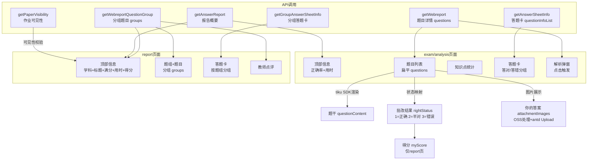

# 答案展示流程文档 (answer-pc)

> 分析对象：
> - `/answer-pc/exam/analysis` (bizCode=204) — 单次答卷分析页
> - `/answer-pc/report` (bizCode=205) — 作业报告页
>
> 分析方式：Edge DevTools MCP 抓取 DOM 结构、API 响应、控制台日志、按钮交互行为
>
> 配套文档：
> - [answer_report_api_doc.md](./answer_report_api_doc.md) — API 接口文档
> - [page_loading_flow_doc.md](./page_loading_flow_doc.md) — 页面加载流程文档

---

## 1. 答案展示总览

### 1.1 两类页面答案展示差异

| 维度 | exam/analysis (bizCode=204) | report (bizCode=205) |
|---|---|---|
| 数据来源 | `GET /api/answerprod/web/answer/webreport` (扁平 `questions[]`) | `GET /api/answerprod/web/answer/webreport/questionGroup` (分组 `groups[]`) |
| 答题卡数据 | `POST .../answerSheetInfo` (扁平 `questionInfoList[]`) | `POST .../groupAnswerSheetInfo` (分组 `groupQuestionList[]`) |
| 顶部信息 | 正确率 + 作答时间 | 学科 + 标题 + 满分 + 用时 + 得分 + 题组统计 |
| 题目组织 | 按 `questionSort` 顺序扁平排列 | 按 `groups[].questions` 分组排列，每组有标题 |
| 题干显示 | 题号 + 题干 | 题号 + **(本题N分)** + 题干 |
| 批改结果 | 正确/错误/半对 (无得分行) | 正确/错误/半对 + **得分行** |
| 解析展示 | 题目底部"解析"按钮 → **弹窗展示** | **不展示**解析（作业报告不公开解析） |
| 知识点 | 解析弹窗中展示 | 顶部信息区 + 题目底部知识点统计区 |
| 推荐微课 | 不展示（`lessons[]` 在顶层但 UI 不渲染） | 不展示（`lessons[]` 嵌在题目内但 UI 不渲染） |
| 教师点评 | 不展示 | 顶部信息区 `teacherReview*` 字段（有则展示） |
| 答题卡分组 | "答错的题" + "答对的题" 两组 | 按**题组**分组，每组带得分 |
| 答题卡操作 | "重新作答" + "下载试卷" | 仅"下载试卷" |
| 题号图标 | `icon-new-right` (全对勾) | `icon-new-right-part` (半对勾) |

### 1.2 答案展示核心组件

```
题库渲染 SDK (common/tiku/library.js)
  └─ pm-question 组件
       ├─ pm-question-content      题干区
       │    ├─ pm-qnum-width        题号
       │    ├─ pm-question-score    (本题N分) [仅 report 页]
       │    ├─ mst-editor-mce-root-block  富文本渲染容器
       │    └─ mst-question-answer-placeholder  答题空位标记
       │
       └─ pm-question-detail        答案详情区
            ├─ pm-list              正确答案行
            │    ├─ pm-label        "正确答案"
            │    ├─ pm-dot          "："
            │    └─ pm-detail-content  答案内容
            │         └─ pm-label-value-item  每个答案项
            │
            ├─ pm-list              批改结果行
            │    ├─ pm-label        "批改结果"
            │    └─ pm-detail-content
            │         ├─ status-correct       "正确" (绿色)
            │         ├─ status-correct-half  "半对" (黄色)
            │         └─ status-correct-error "错误" (红色)
            │
            ├─ pm-list              得分行 [仅 report 页]
            │    ├─ pm-label        "得分"
            │    └─ pm-question-score  "80分"
            │
            └─ pm-list.pm-student-subject-answers  你的答案行
                 ├─ pm-label        "你的答案"
                 └─ pm-question-upload-box  上传图片展示
                      └─ ant-upload-list-picture-card  antd 上传组件
```

---

## 2. exam/analysis 页面答案展示流程

### 2.1 页面布局结构

```
.examination-paper-analysis                    ← 页面根容器
  ├─ .exam-header-in-analysis                  ← 顶部信息区
  │    ├─ .title-of-questions                  ← 标题区
  │    │    └─ .paper-title
  │    │         ├─ <p class="text-line-2">    试卷标题
  │    │         │    "J《六国论》带背与带练1 - 课后习题"
  │    │         └─ .report-answer-time        "用时：54秒"
  │    │
  │    └─ .exam-header-topInfo                 ← 统计信息区
  │         └─ .exam-header-topInfo-content
  │              ├─ .topInfo-status            "正确率 100%"
  │              │    ├─ <div>正确率</div>
  │              │    └─ .topInfo-status-box
  │              │         └─ .topInfo-status-text  "100%"
  │              └─ .topInfo-answer-time       "作答时间：2026年07月31日 18:02"
  │
  ├─ .left-box-of-questions-analysis           ← 左侧题目列表区
  │    ├─ .paper-title                         ← 重复标题
  │    ├─ .question-item-in-analysis           ← 题目1
  │    │    └─ .pm-question
  │    ├─ .question-item-in-analysis           ← 题目2
  │    ├─ .gray-bar-beetween                   ← 灰色分隔条
  │    └─ .knowledge-correct-rate-box          ← 知识点正确率统计
  │
  └─ .right-box-of-questions-analysis          ← 右侧答题卡区
       ├─ .answer-card-detail-title            "答题详情"
       ├─ .rightbox-container
       │    ├─ .answer-card-group.error-items-group  "答错的题"
       │    │    └─ .question-index-box        (空)
       │    └─ .answer-card-group              "答对的题"
       │         └─ .question-index-box
       │              ├─ <li class="item finish">1<i class="iconfont icon-new-right"></i></li>
       │              └─ <li class="item finish">2<i class="iconfont icon-new-right"></i></li>
       ├─ .correct_btn_box
       │    └─ .re-answer-button               "重新作答"
       └─ .paper-download                      "下载试卷"
```

### 2.2 顶部信息渲染（数据来源：`getAnswerReport` API）

```
API 响应 data 字段                  → DOM 映射
─────────────────────────────────────────────────
data.paperName (来自 webreport)     → .paper-title <p> 文本
  实测值: "J《六国论》带背与带练1 - 课后习题"

data.answerTime                     → .report-answer-time
  实测值: "54" (秒) → 渲染为 "用时：54秒"

data.rightRate                      → .topInfo-status-text
  实测值: 1 → 渲染为 "100%"

data.finishAnswerTime               → .topInfo-answer-time
  实测值: "2026-07-31 18:02:13" → 渲染为 "作答时间：2026年07月31日 18:02"
```

### 2.3 题目渲染流程（数据来源：`getWebreport` API）

#### 2.3.1 题干渲染

```
webreport.data.questions[i] 字段        → DOM 映射
─────────────────────────────────────────────────────
questionNoShow: "1"                     → .pm-qnum-width 文本 "1."
questionContent: "<div>背诵默写...</div>" → .mst-editor-mce-root-block innerHTML
  (富文本 HTML，由 tiku/library.js SDK 渲染)

题干中的答题空位:
  mst-question-answer-placeholder        → 数字标记 (1, 2, 3...)
  (在 questionContent HTML 中已预设，SDK 渲染时保持)
```

**题干 HTML 结构**：
```html
<div class="pm-question-content pm-overflowx pm-blanks-normal"
     id="ewt-question-1272506624367480491"
     style="padding-left: 16px;">
  <div class="clearfix pm-content">
    <div class="mst-editor-mce-root-block">
      <span class="pm-qnum-width"
            style="width:16px;margin-left:-16px;display:inline-block;">1.</span>
      <span style="font-family: 宋体, SimSun;">背诵默写《六国论》第一段和第二段。</span>
    </div>
  </div>
  <!-- 答案详情区 -->
  <div class="pm-question-detail pm-question-detail-parent">
    <div class="pm-question-detail-items">
      <!-- 正确答案 -->
      <div class="pm-list">
        <span class="pm-label">正确答案</span>
        <span class="pm-dot">：</span>
        <span class="pm-detail-content">
          <div>
            <span class="pm-label-value-item">
              <div class="mst-editor-mce-root-block">
                <span style="font-family: 宋体, SimSun;">略</span>
              </div>
            </span>
          </div>
        </span>
      </div>
      <!-- 批改结果 -->
      <div class="pm-list">
        <span class="pm-label"><span>批改结果</span></span>
        <span class="pm-dot">：</span>
        <span class="pm-detail-content">
          <span class="pm-detail-content status-correct">正确<span></span></span>
        </span>
      </div>
      <!-- 你的答案（图片） -->
      <div class="pm-list pm-student-subject-answers">
        <span class="pm-label">你的答案</span>
        <span class="pm-dot">：</span>
        <div class="pm-question-upload-box">
          <div class="pm-upload-oss-wrapper" style="display: flex;">
            <span class="ant-upload-picture-card-wrapper">
              <div class="ant-upload-list ant-upload-list-picture-card">
                <div class="ant-upload-list-picture-card-container">
                  <div class="ant-upload-list-item ant-upload-list-item-done">
                    <div class="ant-upload-list-item-info">
                      <span class="ant-upload-span">
                        <a class="ant-upload-list-item-thumbnail"
                           href="https://cdn.ewt360.com/.../5535f2fe-...png"
                           target="_blank">
                          
                        </a>
                      </span>
                    </div>
                    <span class="ant-upload-list-item-actions">
                      <a href="https://cdn.ewt360.com/.../5535f2fe-...png"
                         target="_blank" title="预览文件">
                        <span class="anticon anticon-eye">...</span>
                      </a>
                    </span>
                  </div>
                </div>
              </div>
            </span>
          </div>
        </div>
      </div>
    </div>
  </div>
</div>
```

#### 2.3.2 答案字段映射

```
webreport.data.questions[i] 字段        → DOM 映射
─────────────────────────────────────────────────────
rightAnswer: ["<div>略</div>"]          → .pm-list:nth-child(1) .pm-detail-content
  (数组，每项渲染为 .pm-label-value-item)

rightStatus: 1                          → .pm-detail-content 状态 class
  1 → status-correct     "正确"
  2 → status-correct-half  "半对"
  3 → status-correct-error "错误"

myAnswer / attachmentImages:            → .pm-student-subject-answers
  ["https://.../5535f2fe-...png"]         .pm-question-upload-box
  → antd Upload 组件 (picture-card 模式)
  → 图片 src 自动追加 ?x-oss-process=image/interlace,1/format,jpg
  → 点击可预览大图 (ant-upload-list-item-thumbnail href 指向原图)
```

#### 2.3.3 题目底部操作区

```html
<div class="paper-question-footer">
  <div class="paper-question-footer-correction"
       style="margin-left: 16px;">
    <!-- 教师批注区域（空） -->
  </div>

  <div class="components_feedback_index_module_feedbackButton_iJAIY9ho">
    问题反馈
  </div>

  <div class="analysis-part">
    <div class="mark-btn-wrapper">
      <div class="mark-wrapper">
        <span class="mark-wrapper-btn">
          <span class="anticon anticon-star">...</span>
          <span class="mark-btn-text">收藏</span>
        </span>
      </div>
    </div>
    <button type="button"
            class="ant-btn ant-btn-primary my-study-button">
      <span>解 析</span>
    </button>
  </div>
</div>
```

| 按钮 | 功能 | 行为 |
|---|---|---|
| 问题反馈 | 跳转反馈表单 | 打开反馈弹窗或跳转反馈页 |
| 收藏 | 收藏该题 | 调用收藏 API，`collected` 字段切换 |
| **解析** | **查看题目解析** | **弹出 antd Modal，展示完整解析** |

### 2.4 解析弹窗渲染（点击"解析"按钮触发）

点击"解析"按钮后，弹出 antd Modal，**复用 pm-question 组件**渲染完整解析：

```html
<div class="ant-modal">
  <div class="ant-modal-content">
    <div class="ant-modal-header">
      <div class="ant-modal-title" id="rc_unique_0">习题解析</div>
    </div>
    <div class="ant-modal-body">
      <!-- 复用 pm-question 组件 -->
      <div class="pm-question">
        <div class="pm-question-content">
          <!-- 题干（同主页面） -->
          <div class="mst-editor-mce-root-block">
            <span class="pm-qnum-width">1.</span>
            <span>背诵默写《六国论》第一段和第二段。</span>
          </div>

          <!-- 答案详情区（新增"解析"和"知识点"行） -->
          <div class="pm-question-detail">
            <div class="pm-question-detail-items">
              <!-- 正确答案 -->
              <div class="pm-list">
                <span class="pm-label">正确答案</span>
                <span class="pm-dot">：</span>
                <span class="pm-detail-content">
                  <span class="pm-label-value-item">略</span>
                </span>
              </div>

              <!-- 解析（弹窗特有） -->
              <div class="pm-list pm-label-grammar-has_ans">
                <span class="pm-label">解析</span>
                <span class="pm-dot">：</span>
                <span class="pm-detail-content">
                  <div class="mst-editor-mce-root-block">
                    <span>能够准确默写文章即可，需要特别注意以下字词"赂""弊""邑""暴"。</span>
                  </div>
                </span>
              </div>

              <!-- 知识点（弹窗特有） -->
              <div class="pm-list pm-label-grammar-has_ans">
                <span class="pm-label">知识点</span>
                <span class="pm-dot">：</span>
                <span class="pm-detail-content pm-content-item status-default">
                  <span class="pm-label-value-item pm-knowledge-item">
                    固定篇目情境默写
                  </span>
                </span>
              </div>
            </div>
          </div>
        </div>
      </div>
    </div>
  </div>
</div>
```

**弹窗数据来源**（来自 `webreport.data.questions[i]`）：

```
字段                    → 弹窗 DOM
───────────────────────────────────────
questionContent         → 题干富文本
rightAnswer             → 正确答案行
analyse                 → 解析行 (富文本 HTML)
  实测值: "<div>能够准确默写文章即可...</div>"

knowledges[]            → 知识点标签
  [{id:"1010175", title:"固定篇目情境默写"}]
  → 每项渲染为 .pm-knowledge-item
```

### 2.5 知识点正确率统计渲染

```html
<div class="knowledge-correct-rate-box">
  <h3 class="knowledge-title">各知识点正确率统计</h3>
  <ul class="knowledge-list">
    <li>
      <span class="knowledge-point"
            title="固定篇目情境默写">固定篇目情境默写</span>
      <span class="rate-value">100%</span>
    </li>
  </ul>
</div>
```

**数据来源**（来自 `webreport.data`）：

```
字段                        → DOM
──────────────────────────────────────────
rightKnowledges[]           → .knowledge-list <li>
  [{id:"1010175", title:"固定篇目情境默写", rate:100}]
  → .knowledge-point (title 属性防溢出)
  → .rate-value ("100%")
```

### 2.6 答题卡渲染（数据来源：`getAnswerSheetInfo` API）

```html
<div class="right-box-of-questions-analysis">
  <div class="answer-card-detail-title">
    <i class="iconfont icon-new-pencil-on-paper"></i>
    答题详情
  </div>
  <div class="rightbox-container">
    <!-- 答错的题 -->
    <div class="answer-card-group error-items-group">
      <h4 class="anwser-card-sub-title">答错的题</h4>
      <ul class="question-index-box">
        <!-- 空列表（本题全对） -->
      </ul>
    </div>
    <!-- 答对的题 -->
    <div class="answer-card-group">
      <h4 class="anwser-card-sub-title">答对的题</h4>
      <ul class="question-index-box">
        <li class="item finish">
          1
          <i class="iconfont icon-new-right"></i>
        </li>
        <li class="item finish">
          2
          <i class="iconfont icon-new-right"></i>
        </li>
      </ul>
    </div>
  </div>
  <div class="correct_btn_box">
    <div class="re-answer-button">重新作答</div>
  </div>
  <div class="paper-download paper-download-init">
    <button class="ant-btn ant-btn-default">
      <span><span class="icon ewt-iconfont ewt-icon-xiazai"></span>下载试卷</span>
    </button>
    <div class="paper-download-text">
      <span class="ewt-icon-tishitanhao ewt-iconfont"></span>
      &nbsp;点击"下载试卷"后需等待试卷生成，<br>
      待生成成功后，再次点击"下载试卷"
    </div>
  </div>
</div>
```

**答题卡字段映射**：

```
answerSheetInfo.data.questionInfoList[i]   → DOM
─────────────────────────────────────────────────────
questionNumber: "1"                        → <li> 文本
rightStatus: 1                             → 分组 + 图标
  1 (正确)  → .answer-card-group (答对的题) + icon-new-right
  2 (半对)  → .answer-card-group (答对的题) + icon-new-right-part
  3 (错误)  → .error-items-group (答错的题) + 无勾图标

answerFlag: true                           → .item.finish (已完成标记)
```

---

## 3. report 页面答案展示流程

### 3.1 页面布局结构

```
.report-page                                     ← 页面根容器
  ├─ .routes_report_..._TopInfo_banner_9V5FsKRn  ← 顶部横幅
  │    └─ .routes_report_..._banner_content_9V5FsKRn
  │         ├─ .routes_report_..._banner_title_9V5FsKRn  "「语文」J名篇名句默写带背与带练（必修下）专题测试卷"
  │         └─ .routes_report_..._banner_desc_9V5FsKRn   "答题人：杨旭海"
  │
  ├─ .routes_report_..._TopInfo_9V5FsKRn         ← 统计信息区
  │    ├─ .routes_report_..._TopInfo_main_9V5FsKRn
  │    │    ├─ .routes_report_..._TopInfo_main_correct_9V5FsKRn
  │    │    │    ├─ <p><span class="text-label">满分：</span>100</p>
  │    │    │    └─ <p><span class="text-label">用时：</span>5分55秒
  │    │    │         <span class="text-small">(预估用时60分钟)</span></p>
  │    │    │
  │    │    └─ .routes_report_..._TopInfo_main_score_9V5FsKRn
  │    │         ├─ <p class="text-label">得分</p>
  │    │         └─ <p class="text-score">
  │    │              <span class="text-score-number">80</span>
  │    │              <span class="text-score-unit">分</span>
  │    │            </p>
  │    │
  │    └─ .routes_report_..._TopInfo_right_9V5FsKRn
  │         └─ .routes_report_..._TopInfo_items_9V5FsKRn
  │              └─ .routes_report_..._TopInfo_item_9V5FsKRn
  │                   └─ .routes_report_..._TopInfo_statistics_9V5FsKRn
  │                        └─ .routes_report_..._Statistics_item_9V5FsKRn
  │                             ├─ <p class="text-label text-line-2">名句名篇默写</p>
  │                             └─ <p class="text-score">80分</p>
  │
  ├─ .questions-analysis-box                     ← 题目区域
  │    └─ .questions-analysis-details-box
  │         ├─ .questions-analysis-details-title  "答卷详情"
  │         └─ .question-item-in-analysis
  │              ├─ .question-group-title         ← 题组标题
  │              │    ├─ <span class="question-group-name">一、名句名篇默写</span>
  │              │    └─ <span class="question-group-score">共1题，满分100分，得分80分</span>
  │              │
  │              └─ .question-item-in-analysis.is-subjective-question-box
  │                   └─ .pm-question             ← 题目（同 analysis 页结构）
  │
  └─ .right-box-of                               ← 右侧答题卡
       └─ .right-box-of-questions-analysis
            ├─ .answer-card-detail-title          "答题详情"
            ├─ .question-group-box                ← 按题组分组
            │    ├─ .question-group-title
            │    │    一、名句名篇默写
            │    │    <span class="subTitle">共1题，满分100，得分80</span>
            │    └─ .question-group-card
            │         <ul>
            │           <li class="item finish">
            │             1
            │             <i class="iconfont icon-new-right-part"></i>
            │           </li>
            │         </ul>
            └─ .paper-download                   "下载试卷"
```

### 3.2 顶部信息渲染（数据来源：`getWebreportQuestionGroup` API）

```
API 响应 data 字段                    → DOM 映射
──────────────────────────────────────────────────────────
data.subjectName: "语文"              → banner_title 前缀 "「语文」"
data.title: "J名篇名句默写..."         → banner_title 主体

data.totalScore: 100                  → TopInfo_main_correct "满分：100"
data.useTimeStr: "5分55秒"            → TopInfo_main_correct "用时：5分55秒"
data.totalTimeStr: "60分钟"           → TopInfo_main_correct "(预估用时60分钟)"

data.myTotalScore: 80                 → TopInfo_main_score
  → .text-score-number "80"
  → .text-score-unit "分"

data.groups[]                         → TopInfo_right 题组统计
  groups[0].groupName: "名句名篇默写"  → .Statistics_item .text-label
  groups[0].myTotalScore: 80          → .Statistics_item .text-score "80分"

(答题人姓名来自 user/baseinfo API)
user.realName: "杨旭海"               → banner_desc "答题人：杨旭海"
```

### 3.3 题组标题渲染

```html
<div class="question-group-title">
  <span class="question-group-name">一、名句名篇默写</span>
  <span class="question-group-score">共1题，满分100分，得分80分</span>
</div>
```

**数据来源**：

```
webreport.questionGroup.data.groups[i] 字段    → DOM
─────────────────────────────────────────────────────────
groupSort: 1                                  → "一、" (中文序号)
groupName: "名句名篇默写"                      → .question-group-name
totalQuestions: 1                             → "共1题"
totalScore: 100                               → "满分100分"
myTotalScore: 80                              → "得分80分"
```

### 3.4 题目渲染（与 analysis 页差异）

report 页面题目复用同一 `pm-question` 组件，但有以下差异：

#### 3.4.1 题干差异

```html
<!-- report 页题干多了分数标注 -->
<div class="mst-editor-mce-root-block">
  <span class="pm-qnum-width">1.</span>
  <span class="pm-question-score">(本题100分)</span>  <!-- 仅 report 页 -->
  <span>（1）《子路、曾皙、冉有、公西华侍坐》中...</span>
</div>
```

```
字段映射:
data.questions[i].score: 100  →  .pm-question-score "(本题100分)"
```

#### 3.4.2 答案详情差异

```html
<div class="pm-question-detail">
  <div class="pm-question-detail-items">
    <!-- 正确答案（多空题按编号展示） -->
    <div class="pm-list">
      <span class="pm-label">正确答案</span>
      <span class="pm-dot">：</span>
      <span class="pm-detail-content">
        <span class="pm-label-value-item pm-ana-item-with-inline">
          1、<div class="mst-editor-mce-root-block">以吾一日长乎尔</div>
        </span>
        <span class="pm-label-value-item pm-ana-item-with-inline">
          2、<span>毋吾以也</span>
        </span>
        <!-- ... 50 个空位答案 ... -->
      </span>
    </div>

    <!-- 批改结果 -->
    <div class="pm-list">
      <span class="pm-label"><span>批改结果</span></span>
      <span class="pm-dot">：</span>
      <span class="pm-detail-content">
        <span class="pm-detail-content status-correct-half">半对<span></span></span>
      </span>
    </div>

    <!-- 得分行（仅 report 页） -->
    <div class="pm-list">
      <span class="pm-label">得分</span>
      <span class="pm-dot">：</span>
      <span class="pm-detail-content">
        <span class="pm-question-score">80分</span>
      </span>
    </div>

    <!-- 你的答案（图片） -->
    <div class="pm-list pm-student-subject-answers">
      <span class="pm-label">你的答案</span>
      <span class="pm-dot">：</span>
      <div class="pm-question-upload-box">
        <div class="ant-upload-list ant-upload-list-picture-card">
          <div class="ant-upload-list-picture-card-container">
            <div class="ant-upload-list-item ant-upload-list-item-done">
              <a class="ant-upload-list-item-thumbnail"
                 href="https://cdn.ewt360.com/.../1785848091224-answer_1281415130642573902.png"
                 target="_blank">
                
              </a>
              <a class="ant-upload-list-item-name"
                 href="https://cdn.ewt360.com/.../1785848091224-answer_1281415130642573902.png"
                 target="_blank">0.png</a>
              <span class="ant-upload-list-item-actions">
                <a title="预览文件"><span class="anticon anticon-eye"></span></a>
              </span>
            </div>
          </div>
        </div>
      </div>
    </div>
  </div>
</div>
```

**report 页特有字段映射**：

```
data.questions[i] 字段        → DOM
──────────────────────────────────────────
score: 100                   → .pm-question-score "(本题100分)" (题干中)
myScore: 80                  → .pm-question-score "80分" (得分行)
rightAnswer: ["答案1", "答案2", ...]
  多空题按编号展示             → .pm-label-value-item "1、答案1" "2、答案2" ...
rightStatus: 2               → .status-correct-half "半对"
```

#### 3.4.3 答案图片展示规则

```
attachmentImages / myAnswer 字段:
  ["https://cdn.ewt360.com/resources/answer-pc/uploads/1785848091224-answer_1281415130642573902.png"]
    ↓
  图片 URL 自动追加 OSS 处理参数:
  ?x-oss-process=image/interlace,1/format,jpg
    ↓
  渲染为 antd Upload 组件 (picture-card 模式):
  - 缩略图 (ant-upload-list-item-image) 使用处理后的 URL
  - 点击预览 (ant-upload-list-item-thumbnail) 使用原图 URL
  - 文件名 (ant-upload-list-item-name) 显示原始文件名 "0.png"
  - 预览按钮 (ant-upload-list-item-actions) 使用 antd eye 图标
```

### 3.5 答题卡渲染（数据来源：`getGroupAnswerSheetInfo` API）

```html
<div class="right-box-of-questions-analysis">
  <div class="answer-card-detail-title">答题详情</div>
  <div class="question-group-box">
    <!-- 每个题组一个分组 -->
    <div class="question-group-title">
      一、名句名篇默写
      <span class="subTitle">共1题，满分100，得分80</span>
    </div>
    <div class="question-group-card">
      <ul>
        <li class="item finish">
          1
          <i class="iconfont icon-new-right-part"></i>
        </li>
      </ul>
    </div>
  </div>
  <div class="paper-download">
    <button class="ant-btn ant-btn-default">
      <span><span class="icon ewt-iconfont ewt-icon-xiazai"></span>下载试卷</span>
    </button>
    <div class="paper-download-text">
      点击"下载试卷"后需等待试卷生成，待生成成功后，再次点击"下载试卷"
    </div>
  </div>
</div>
```

**答题卡字段映射**（与 analysis 页不同）：

```
groupAnswerSheetInfo.data.groupQuestionList[i]   → DOM
─────────────────────────────────────────────────────────────
groupSort: 1                                    → "一、"
groupName: "名句名篇默写"                        → .question-group-title 文本
totalQuestions: 1                               → "共1题"
totalScore: 100                                 → "满分100"
myTotalScore: 80                                → "得分80"

questionInfoList[j]                             → .question-group-card <li>
  questionNumber: "1"                           → <li> 文本
  rightStatus: 2                                → 图标选择
    1 → icon-new-right        (全对勾)
    2 → icon-new-right-part   (半对勾)
    3 → 无勾图标              (错题)
  answerFlag: true                              → .item.finish

注意：report 页答题卡不分组为"答对的题/答错的题"，
      而是按题组分组，每组内题号按 rightStatus 显示不同图标。
```

---

## 4. 完整答案展示流程时序

### 4.1 exam/analysis 页面答案展示时序

```
[阶段 1: 数据获取]
  React 组件 mount
    ↓
  useEffect 触发并行 API 调用:
    ├─ getAnswerReport(paperId, reportId, bizCode=204)
    │    → 返回报告概要 (rightRate, answerTime, finishAnswerTime)
    │
    ├─ getWebreport(paperId, reportId, userId, bizCode=204)
    │    → 返回完整题目列表 questions[]
    │      每题包含: questionContent, rightAnswer, myAnswer,
    │               rightStatus, analyse, knowledges
    │
    └─ getAnswerSheetInfo(paperId, reportId, userId, bizCode=204)
         → 返回答题卡 questionInfoList[]
           每题包含: questionNumber, rightStatus, answerFlag

[阶段 2: 顶部信息渲染]
  getAnswerReport.data 返回后:
    ├─ paperName → .paper-title
    ├─ answerTime → .report-answer-time "用时：X秒"
    ├─ rightRate → .topInfo-status-text "X%"
    └─ finishAnswerTime → .topInfo-answer-time "作答时间：YYYY年MM月DD日 HH:mm"

[阶段 3: 题目列表渲染]
  getWebreport.data.questions 返回后:
    ├─ 按 questionSort 排序
    ├─ 遍历 questions[]:
    │    ├─ 渲染 .question-item-in-analysis 容器
    │    ├─ tiku/library.js 渲染 questionContent → .pm-question-content
    │    │    (解析 HTML 富文本，保留 mst-question-answer-placeholder 空位标记)
    │    ├─ 渲染 rightAnswer[] → .pm-list "正确答案"
    │    ├─ 根据 rightStatus 渲染 → .pm-list "批改结果"
    │    │    1 → status-correct "正确"
    │    │    2 → status-correct-half "半对"
    │    │    3 → status-correct-error "错误"
    │    ├─ 渲染 myAnswer/attachmentImages → .pm-student-subject-answers
    │    │    图片 URL + ?x-oss-process=image/interlace,1/format,jpg
    │    │    antd Upload picture-card 组件
    │    └─ 渲染底部操作区 .paper-question-footer
    │         "问题反馈" | "收藏" | "解析" 按钮
    │
    └─ 渲染知识点统计 .knowledge-correct-rate-box
         遍历 rightKnowledges[]:
           title → .knowledge-point
           rate → .rate-value "X%"

[阶段 4: 答题卡渲染]
  getAnswerSheetInfo.data.questionInfoList 返回后:
    ├─ 按 rightStatus 分组:
    │    rightStatus=3 → .error-items-group "答错的题"
    │    rightStatus=1/2 → .answer-card-group "答对的题"
    │
    ├─ 遍历每题:
    │    questionNumber → <li> 文本
    │    rightStatus → 图标 (icon-new-right / icon-new-right-part)
    │    answerFlag=true → .item.finish
    │
    └─ 渲染底部操作:
         "重新作答" 按钮 → 跳转答题页
         "下载试卷" 按钮 → 触发下载流程

[阶段 5: 解析弹窗（用户点击触发）]
  用户点击"解析"按钮:
    ├─ 从 questions[i] 取出该题数据
    ├─ 弹出 antd Modal (标题 "习题解析")
    ├─ 复用 pm-question 组件渲染:
    │    ├─ 题干 (questionContent)
    │    ├─ 正确答案 (rightAnswer)
    │    ├─ 解析 (analyse) → .pm-list "解析"
    │    └─ 知识点 (knowledges) → .pm-list "知识点"
    │         每个 knowledge → .pm-knowledge-item
    └─ 用户点击"关闭"或遮罩关闭弹窗

[阶段 6: 图片懒加载]
  题目渲染完成后:
    ├─ 答题图片 (cdn.ewt360.com/resources/answer-pc/uploads/...)
    │    带 OSS 处理参数: ?x-oss-process=image/interlace,1/format,jpg
    │    渐进式加载 + 转 jpg 减体积
    │
    └─ 图标字体 (iconfont.woff2)
         antd 图标 + 自定义图标
```

### 4.2 report 页面答案展示时序

```
[阶段 1: 数据获取]
  React 组件 mount
    ↓
  useEffect 触发:
    ├─ getPaperVisibility(paperId, reportId, homeworkId)
    │    → 返回 false 时显示"作业不可见"，阻断后续渲染
    │
    ├─ getAnswerReport(paperId, reportId, bizCode=205, homeworkId)
    │    → 返回报告概要 (rightRate, answerTime, assignPoints)
    │
    ├─ getWebreportQuestionGroup(paperId, reportId, homeworkId, userId)
    │    → 返回分组报告 data.groups[]
    │      顶层: subjectName, title, myTotalScore, totalScore,
    │            useTimeStr, totalTimeStr, teacherReview*
    │      groups[].questions[]: 同 analysis 页 + score/myScore/scoreList
    │
    └─ getGroupAnswerSheetInfo(paperId, reportId, homeworkId, userId)
         → 返回分组答题卡 groupQuestionList[]

[阶段 2: 顶部信息渲染]
  getWebreportQuestionGroup.data 返回后:
    ├─ subjectName + title → banner_title "「语文」标题"
    ├─ user.realName → banner_desc "答题人：XXX"
    ├─ totalScore → TopInfo_main_correct "满分：100"
    ├─ useTimeStr + totalTimeStr → "用时：5分55秒(预估用时60分钟)"
    ├─ myTotalScore → TopInfo_main_score
    │    .text-score-number "80"
    │    .text-score-unit "分"
    └─ groups[] → TopInfo_right 题组统计
         每组: groupName + myTotalScore → .Statistics_item

  (可选) teacherReview* 字段:
    teacherReviewScore → 教师评分
    teacherReviewRank → 教师评级 (A+/A/B/C/D)
    teacherReviewComment → 教师评语
    teacherReviewImageList → 教师评语图片

[阶段 3: 题组+题目渲染]
  getWebreportQuestionGroup.data.groups 返回后:
    ├─ 遍历 groups[]:
    │    ├─ 渲染题组标题 .question-group-title
    │    │    groupSort → "一、" (中文序号)
    │    │    groupName → .question-group-name
    │    │    totalQuestions + totalScore + myTotalScore
    │    │      → .question-group-score "共X题，满分X分，得分X分"
    │    │
    │    └─ 遍历 groups[].questions[]:
    │         ├─ 渲染 .question-item-in-analysis.is-subjective-question-box
    │         ├─ tiku/library.js 渲染 questionContent
    │         │    + score → .pm-question-score "(本题100分)"
    │         ├─ 渲染 rightAnswer[] → .pm-list "正确答案"
    │         │    多空题: "1、答案1" "2、答案2" ...
    │         ├─ 根据 rightStatus 渲染 → .pm-list "批改结果"
    │         ├─ 渲染 myScore → .pm-list "得分" (仅 report 页)
    │         │    "80分"
    │         └─ 渲染 myAnswer/attachmentImages → .pm-student-subject-answers
    │              图片展示 (同 analysis 页)

[阶段 4: 答题卡渲染]
  getGroupAnswerSheetInfo.data.groupQuestionList 返回后:
    ├─ 遍历 groupQuestionList[]:
    │    ├─ 渲染题组标题 .question-group-title
    │    │    groupName + totalQuestions + totalScore + myTotalScore
    │    │
    │    └─ 渲染题号列表 .question-group-card
    │         遍历 questionInfoList[]:
    │           questionNumber → <li> 文本
    │           rightStatus → 图标
    │             1 → icon-new-right (全对)
    │             2 → icon-new-right-part (半对)
    │             3 → 无图标 (错误)
    │           answerFlag → .item.finish
    │
    └─ 渲染"下载试卷"按钮
         (无"重新作答"按钮)

[阶段 5: 图片懒加载]
  同 analysis 页
```

---

## 5. 题库渲染 SDK (tiku/library.js)

### 5.1 SDK 作用

`tiku/library.js` 是题库渲染 SDK，负责将后端返回的题目富文本 HTML 渲染为可视化的题目内容。

### 5.2 渲染流程

```
后端返回 questionContent (HTML 字符串):
  "<div>背诵默写《六国论》第一段和第二段。</div>"
    ↓
tiku SDK 解析 HTML:
  1. 识别 .mst-editor-mce-root-block 容器
  2. 保留内联样式 (font-family, text-align 等)
  3. 识别 .mst-question-answer-placeholder 空位标记
     → 渲染为数字编号 (1, 2, 3...)
  4. 识别 <br> 换行
  5. 识别子题 (childQuestions) 嵌套结构
    ↓
渲染到 .pm-question-content 容器:
  <div class="pm-question-content pm-overflowx pm-blanks-normal"
       id="ewt-question-{questionId}">
    <div class="clearfix pm-content">
      <div class="mst-editor-mce-root-block">
        <span class="pm-qnum-width">1.</span>
        <span style="font-family: 宋体, SimSun;">题干文本</span>
        <span class="mst-question-answer-placeholder">1</span>
        <span style="font-family: 宋体, SimSun;">，</span>
        <span class="mst-question-answer-placeholder">2</span>
      </div>
    </div>
  </div>
```

### 5.3 关键 CSS 类

| CSS 类 | 作用 |
|---|---|
| `pm-question-content` | 题干容器 |
| `pm-overflowx` | 横向溢出处理 |
| `pm-blanks-normal` | 空位正常显示模式 |
| `pm-content` | 内容包裹层 |
| `mst-editor-mce-root-block` | 富文本根块 (TinyMCE 格式) |
| `pm-qnum-width` | 题号宽度占位 |
| `pm-question-score` | 题目分数标注 |
| `mst-question-answer-placeholder` | 答题空位标记 (渲染为数字) |
| `pm-question-detail` | 答案详情区 |
| `pm-question-detail-parent` | 父级答案详情 |
| `pm-question-detail-items` | 答案项列表 |
| `pm-list` | 单行答案 |
| `pm-label` | 标签 ("正确答案"/"批改结果"/"得分"/"你的答案"/"解析"/"知识点") |
| `pm-dot` | 冒号分隔符 |
| `pm-detail-content` | 答案内容 |
| `pm-label-value-item` | 单个答案项 |
| `pm-ana-item-with-inline` | 行内答案项 (多空题) |
| `pm-knowledge-item` | 知识点标签 |
| `pm-student-subject-answers` | 学生答案区 |
| `pm-question-upload-box` | 上传图片容器 |
| `pm-upload-oss-wrapper` | OSS 图片包装 |

### 5.4 批改结果状态 CSS

| rightStatus 值 | CSS 类 | 文本 | 颜色 |
|---|---|---|---|
| 1 | `status-correct` | 正确 | 绿色 |
| 2 | `status-correct-half` | 半对 | 黄色 |
| 3 | `status-correct-error` | 错误 | 红色 |

---

## 6. 图片展示机制

### 6.1 学生答题图片

```
数据来源:
  webreport.data.questions[i].myAnswer / attachmentImages
  实测值: ["https://cdn.ewt360.com/resources/answer-pc/uploads/2026/7/31/5535f2fe-...png"]

渲染流程:
  1. 原图 URL: https://cdn.ewt360.com/resources/answer-pc/uploads/.../XXX.png
  2. 缩略图 URL: 原图 + ?x-oss-process=image/interlace,1/format,jpg
     - interlace,1: 渐进式加载 (先模糊后清晰)
     - format,jpg: 转 jpg 减小体积
  3. antd Upload 组件 (picture-card 模式):
     - 缩略图: .ant-upload-list-item-image
     - 预览链接: .ant-upload-list-item-thumbnail (href 指向原图)
     - 文件名: .ant-upload-list-item-name (显示原始文件名 "0.png")
     - 操作区: .ant-upload-list-item-actions
       - 预览按钮: antd eye 图标
  4. 点击预览: 新窗口打开原图 (target="_blank")
```

### 6.2 推荐微课封面（如展示）

```
数据来源:
  webreport.data.lessons[].img (analysis 页)
  webreport.data.groups[].questions[].lessons[].img (report 页)

渲染:
  
  或视频封面: https://vod01.ewt360.com/.../snapshots/...jpg
```

> 注意：实测两类页面均**未渲染推荐微课区域**，`lessons[]` 数据虽返回但 UI 不展示。

---

## 7. 答题卡交互逻辑

### 7.1 exam/analysis 页面答题卡

```
答题卡结构:
  "答错的题" (error-items-group)
    → rightStatus=3 的题目编号
    → 无勾选图标

  "答对的题" (answer-card-group)
    → rightStatus=1 或 2 的题目编号
    → icon-new-right (全对) 或 icon-new-right-part (半对)

交互:
  1. 点击题号 → 滚动到对应题目位置 (锚点跳转)
  2. "重新作答" → 跳转到答题页 (/answer-pc/exam/answer?...)
  3. "下载试卷" → 两步下载:
     a. 第一次点击: 触发后端生成 PDF (异步)
     b. 等待生成完成
     c. 第二次点击: 下载已生成的 PDF
```

### 7.2 report 页面答题卡

```
答题卡结构:
  按题组分组 (question-group-box):
    题组1: "一、名句名篇默写 共1题，满分100，得分80"
      → 题号列表 (question-group-card)
        1 [icon-new-right-part] (半对)
    题组2: ...

交互:
  1. 点击题号 → 滚动到对应题目位置
  2. "下载试卷" → 同 analysis 页
  3. 无"重新作答"按钮 (作业报告不允许重做)
```

---

## 8. 特殊场景处理

### 8.1 作业不可见（report 页特有）

```
getPaperVisibility 返回 false 时:
  → 页面显示"作业不可见"提示
  → 阻断后续 API 调用
  → 不渲染题目内容

实测场景:
  教师在后台关闭了作业查看权限
  paperVisibility.data = false
```

### 8.2 未批改完成

```
correctResult.hasCorrect = false 时:
  → 题目"批改结果"行显示"待批改"
  → "你的答案"行正常展示
  → "正确答案"行可能不展示 (取决于 correctResult 配置)

实测场景:
  客观题自动批改完成，主观题等待教师批改
```

### 8.3 AI 答疑权限关闭

```
getAnswerAIQAPermission 返回:
  {success: false, code: "9984001", msg: "本学科已关闭试题AI答疑"}

  → 不渲染 AI 答疑按钮
  → 或渲染但置灰不可点击

实测场景:
  语文学科默认关闭 AI 答疑功能
```

### 8.4 重新批改

```
checkReCorrect 返回 data=1 时:
  → 题目底部显示"申请重新批改"按钮
  → 点击后调用重新批改 API
  → 批改完成后刷新报告

返回 data=0 时:
  → 不显示"申请重新批改"按钮
```

---

## 9. 数据流总览（mermaid）



---

## 10. 关键渲染规则总结

1. **题干富文本由 tiku/library.js SDK 渲染**：后端返回的 `questionContent` 是 HTML 字符串，SDK 解析后保留内联样式、识别空位标记、处理子题嵌套；
2. **批改结果三态展示**：`rightStatus` 1/2/3 对应绿/黄/红三色，CSS 类为 `status-correct` / `status-correct-half` / `status-correct-error`；
3. **答题图片 OSS 处理**：所有图片自动追加 `?x-oss-process=image/interlace,1/format,jpg` 实现渐进式加载和格式转换；
4. **解析默认折叠**：analysis 页面解析不在主页面展示，需点击"解析"按钮弹出 Modal；report 页面不展示解析（作业报告不公开解析）；
5. **答题卡两类分组方式**：analysis 页按"答对/答错"二分组；report 页按"题组"多分组，每组带得分；
6. **得分仅 report 页展示**：`assignPoints=true` 时才有 `score/myScore/scoreList` 字段，analysis 页 `assignPoints=false` 不展示得分；
7. **题组标题中文序号**：`groupSort` 转为中文序号（一、二、三...）；
8. **图片预览双链接**：缩略图用 OSS 处理后的 URL，点击预览用原图 URL，新窗口打开；
9. **作业可见性前置校验**：report 页首先调用 `getPaperVisibility`，返回 false 时阻断后续渲染；
10. **推荐微课数据有但 UI 不渲染**：`lessons[]` 字段在 API 响应中存在，但两类页面均未在 UI 中展示（可能是预留功能或由其他入口触发）。
