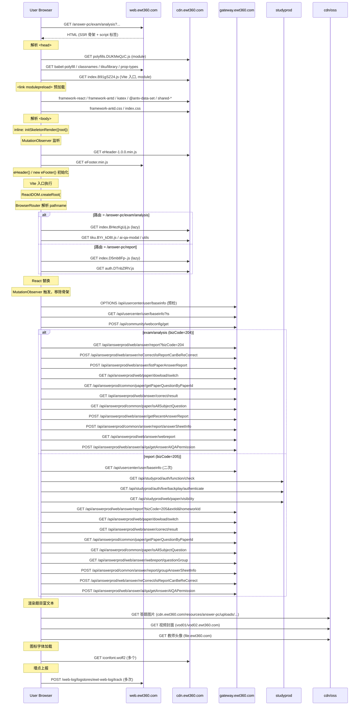

# 答题报告/分析页面 (answer-pc) 详细加载流程文档

> 分析对象：
> - `https://web.ewt360.com/answer-pc/exam/analysis` (bizCode=204)
> - `https://web.ewt360.com/answer-pc/report` (bizCode=205)
>
> 分析方式：Edge DevTools MCP 抓取 head/body 全部 `<script>` 标签、`<link>` 资源、控制台日志、网络请求时序
>
> 关键结论：**两类页面是同一个 Vite + React SPA 应用**，HTML 入口、脚本顺序、骨架屏机制完全一致，仅 `location.pathname` 不同触发不同路由组件，进而调用不同的 API 集合。

---

## 1. 应用技术栈

| 维度 | 实现 |
|---|---|
| 构建工具 | **Vite** (从 `__vite_is_modern_browser` / `vite-legacy-polyfill` / `vite-legacy-entry` / modulepreload 等标志判定) |
| 框架 | **React** (从 `framework-react.D2vtZO7R.js` chunk 名 + `prop-types` 依赖判定) |
| UI 库 | **Ant Design** (`framework-antd.*.js` + `@ant-design-icons` CSS) + **Ant Design Mobile** (`framework-antd-mobile.*.js`) |
| 路由 | 基于 `history` API（`window.history` 为 object），BrowserRouter 模式（无 `#`） |
| 数学渲染 | **KaTeX** (`katex-vendor.BNbY5MC3.js`) |
| 数据可视化 | **@antv/data-set** (`@antv-data-set-vendor.lGe4XDVY.js`，用于知识点正确率图表) |
| 动画 | **lottie-web** (`lottie-web-vendor.CM4Q-n3k.js`) |
| 埋点 | **QuickTracking SDK** (`o.alicdn.com/QTSDK/quicktracking-sdk/qt_web.umd.js` + `aplus_queue`) |
| 骨架屏 | 自研 `initSkeletonRender` (MutationObserver 监听真实内容挂载后移除骨架) |
| 兼容方案 | Vite legacy 插件 (`polyfills-legacy.BtA1OYku.js` + `System.import`) |
| 暗黑模式 | **DarkReader** 浏览器扩展注入（非应用自带，`data-darkreader-mode="dynamic"`） |

---

## 2. HTML 入口结构（head 顺序）

入口 HTML 由后端模板渲染，包含以下关键节点（按出现顺序）：

### 2.1 `<html>` 根元素属性
```html
<html data-darkreader-mode="dynamic" data-darkreader-scheme="dark">
```
（`data-darkreader-*` 为浏览器扩展注入，非应用本身）

### 2.2 `<meta>` 标签（按顺序）
| # | name | content | 作用 |
|---|---|---|---|
| 1 | `x-ua-compatible` | `ie=edge` | IE 兼容模式 |
| 2 | `Pragma` | `no-cache` | 禁缓存 |
| 3 | `Cache-Control` | `no-cache` | 禁缓存 |
| 4 | `Expires` | `0` | 禁缓存 |
| 5 | `viewport` | `width=device-width,initial-scale=1,maximum-scale=1,user-scalable=no` | 移动端适配（禁缩放） |
| 6 | `Keywords` | 升学e网通,在线教育,... | SEO |
| 7 | `Description` | 升学e网通是杭州铭师堂教育... | SEO |
| 8 | `darkreader` | `d7638da6d50a46859e0402ca9c4dfd5f` | DarkReader 扩展标识 |

### 2.3 `<link>` 资源（按顺序）

| # | rel | 资源 | 用途 |
|---|---|---|---|
| 1 | `shortcut icon` | `https://common.ewt360.com/favicon.ico` | 站点图标 |
| 2-N | `modulepreload` | `@antv-data-set-vendor`, `framework-react`, `framework-antd`, `framework-antd-mobile`, `shared-*`, `katex-vendor`, `index.*` 等 | Vite 预加载 ESM 模块（关键路径加速） |
| M-N | `stylesheet` | `framework-antd.*.css`, `framework-antd-mobile.*.css`, `shared-*.css`, `index.*.css` 等 | Vite 入口 CSS |

### 2.4 `<head>` 中的 `<script>`（按 DOM 顺序，共 14 个）

> 这是关键：所有 head 脚本均为同步阻塞或 module（defer 行为），决定初始化时序。

| # | src / inline | type | async | 用途 |
|---|---|---|---|---|
| 0 | `o.alicdn.com/QTSDK/quicktracking-sdk/qt_web.umd.js` | classic | ✅ true | QuickTracking 埋点 SDK（异步加载，不阻塞） |
| 1 | `(inline, 36B)` | classic | - | `window.__MST_REAL_LABEL__="baseline"` (AB 实验标签) |
| 2 | `cdn.ewt360.com/.../polyfills.DUKMeQzC.js` | **module** | - | Vite 现代浏览器 polyfill |
| 3 | `(inline, 33B)` | classic | - | `window.compatibilityDisplayMode=1` |
| 4 | `cdn.ewt360.com/.../high-availability-legacy_v1.3.0.min.js` | classic | - | 高可用容灾 SDK（旧浏览器） |
| 5 | `web.ewt360.com/common/babel-polyfill.min.js` | classic | - | Babel polyfill |
| 6 | `(inline, 79B)` | classic | - | `"undefined"==typeof window\|\|window.ShadowRoot\|\|(window.ShadowRoot=function(){})` |
| 7 | `web.ewt360.com/common/classnames.min.js` | classic | - | `classnames` 工具库 |
| 8 | `web.ewt360.com/common/tiku/library.js` | classic | - | 题库渲染 SDK（试题 HTML 富文本渲染） |
| 9 | `web.ewt360.com/common/prop-types/prod/15.7.2/prop-types.min.js` | classic | - | React PropTypes（生产版） |
| 10 | `cdn.ewt360.com/.../index.B91gSZ24.js` | **module** | - | **Vite 应用入口**（React 根组件 + 路由） |
| 11 | `(inline, 106B, module)` | module | - | `import.meta.url,import("_").catch((()=>1)),async function*(){}.next(),window.__vite_is_modern_browser=!0` (Vite 现代浏览器嗅探) |
| 12 | `(inline, 395B, module)` | module | - | Vite legacy 回退逻辑：若 `!__vite_is_modern_browser` 则加载 legacy polyfill + `System.import(legacy-entry)` |
| 13 | `quickaplus-he-api-cn-shanghai.aliyuncs.com/rcfg.js?_abfpc=...&ak=...` | text/javascript | ✅ true | QuickTracking 远程配置（异步） |

### 2.5 `<body>` 中的 `<script>`（按 DOM 顺序，共 9 个）

| # | src / inline | 用途 |
|---|---|---|
| 0 | `(inline, 1081B)` | **自研骨架屏渲染器** `window.initSkeletonRender`：用 MutationObserver 监听 `#root` 子节点变化，挂载后自动移除骨架 DOM |
| 1 | `(inline, 139B)` | 调用 `initSkeletonRender({skeletonListenerId:"root", skeletonContent: document.querySelector(".answer_pc_skeleton-wrapper")})` |
| 2 | `cdn.ewt360.com/.../common-header/dist/eHeader-1.0.0.min.js` | **公共头部** SDK（登录态、用户菜单） |
| 3 | `(inline, 92B)` | `let header=eHeader(null,!0); header.BindLogoutEvent(()=>window.location.reload(!0))` (初始化头部 + 退出登录回调) |
| 4 | `web.ewt360.com/web-www/common-footer/eFooter.min.js` | **公共尾部** SDK |
| 5 | `(inline, 68B)` | `try{var footer=new eFooter}catch(o){console.log(...)}` (初始化尾部) |
| 6 | `(inline, 313B)` | Vite `nomodule` 嗅探（旧浏览器检测） |
| 7 | `cdn.ewt360.com/.../polyfills-legacy.BtA1OYku.js` | **Vite legacy polyfill**（仅旧浏览器执行） |
| 8 | `(inline, 84B)` | `System.import(document.getElementById("vite-legacy-entry").getAttribute("data-src"))` (旧浏览器入口) |

### 2.6 `#root` 初始内容（SSR 注入的骨架）

入口 HTML 不是空 `#root`，而是后端预先渲染的**最小骨架 HTML**：

```html
<div id="root" style="min-height:calc(100vh - 36px - 305px)">
  <div class="main-container">
    <div class="core-layout__viewport">
      <!-- exam/analysis 路由 -->
      <div class="examination-paper-analysis">
        <div class="exam-header-in-analysis">
          <div class="title-of-questions">
            <div class="paper-title">
              <p class="text-line-2">J《六国论》带背与带练1 - 课后习题</p>
              <div class="report-answer-time">用时：54秒</div>
            </div>
          </div>
          <div class="exam-header-topInfo">...</div>
        </div>
        ...
      </div>

      <!-- 或 report 路由 -->
      <div class="report-page">
        <div class="routes_report_components_TopInfo_index_module_TopInfo_banner_9V5FsKRn">
          <div class="..._title_9V5FsKRn text-line-1">「语文」J名篇名句默写带背与带练（必修下）专题测试卷</div>
          <div class="..._desc_9V5FsKRn"><span style="opacity: 0.5;">答题人：</span>杨旭海</div>
        </div>
        ...
      </div>
    </div>
  </div>
</div>
```

> 关键：**后端 SSR 已注入了报告标题、用户姓名等基础信息**，所以首屏可见"立即可见"的内容并非空白色骨架；React hydration 之前用户就能看到标题。

---

## 3. 加载时序总览（实测时间戳）

> 以下时间戳来自 console 日志与 network 抓包（北京时间 2026-08-04 23:38）

```
T+0ms      浏览器发起 GET https://web.ewt360.com/answer-pc/exam/analysis?...
           ↓ 服务端返回 HTML（含 SSR 骨架）
           
T+~50ms    浏览器解析 <head>，按顺序执行：
           [1] inline: window.__MST_REAL_LABEL__="baseline"
           [2] polyfills.DUKMeQzC.js (module, defer)
           [3] inline: window.compatibilityDisplayMode=1
           [4] high-availability-legacy_v1.3.0.min.js
           [5] babel-polyfill.min.js
           [6] inline: ShadowRoot polyfill
           [7] classnames.min.js
           [8] tiku/library.js  (题库渲染 SDK)
           [9] prop-types.min.js
           [10] index.B91gSZ24.js (module, Vite 应用入口)
           [11] inline module: __vite_is_modern_browser=!0
           [12] inline module: legacy 回退逻辑（跳过）
           
T+~100ms   <head> 解析完成，浏览器开始预加载 modulepreload 的 chunks：
           - framework-react.D2vtZO7R.js
           - framework-antd.V9DPiEyI.js
           - framework-antd-mobile.BHQy5JwR.js
           - @antv-data-set-vendor.lGe4XDVY.js
           - katex-vendor.BNbY5MC3.js
           - shared-*.js (多个共享 chunk)
           - index.D1TZaqiM.js (主入口 chunk)
           以及入口 CSS：
           - framework-antd.CxnIhW2q.css
           - framework-antd-mobile.4seI-20t.css
           - shared-hZ0qNeAu.wRAqashs.css
           - index.cKPQLJ1x.css
           
T+~150ms   <body> 解析：
           [14] inline: initSkeletonRender 定义
           [15] inline: initSkeletonRender({skeletonListenerId:"root", ...})
                → 启动 MutationObserver 监听 #root 变化
           [16] eHeader-1.0.0.min.js (公共头部 SDK)
           [17] inline: header = eHeader(null, true); header.BindLogoutEvent(...)
                → 初始化头部登录态
           [18] eFooter.min.js (公共尾部 SDK)
           [19] inline: new eFooter() (初始化尾部)
           [20] inline: nomodule 嗅探
           [21] polyfills-legacy.BtA1OYku.js (旧浏览器 polyfill)
           [22] inline: System.import(vite-legacy-entry) (旧浏览器入口)
           
T+~200ms   入口 CSSOM + DOM 都已就绪，React 应用开始挂载：
           - 入口 index.B91gSZ24.js 加载完后执行
           - React Router 解析 location.pathname
           - 根据 /answer-pc/exam/analysis 或 /answer-pc/report 匹配路由
           - 加载路由对应的 lazy chunk：
             · examination-paper-analysis → index.BHezKgUj.js + shared-zRahSF9D + utils + tiku + ai-qa-modal + use-records-cursor-list
             · report-page → index.D5mb8Fp-.js + auth.DTnbZlRV.js + ...
           
T+~8000ms  (console) 15:38:08.428 [LOG] "开始监听 1785857888425"
           → 油猴脚本（EWT 学习助手）开始注入
           
T+~9000ms  (console) 15:38:09.098 [LOG] [EWT学习助手] [启动] 脚本已加载
           (console) 15:38:09.101 [LOG] [EWT学习助手] [检测] 专注度检测监控已启动
           (console) 15:38:09.107 [LOG] [EWT学习助手] [初始化] 悬浮球已加载 // v5.0 material-geek
           
T+~10000ms (console) 15:38:10.109 [WARN] [QT] -- QuickTracking SDK INIT SUCCESS!
           → QuickTracking 埋点 SDK 初始化完成
```

---

## 4. 网络请求时序（精确到调用顺序）

### 4.1 阶段 A：静态资源加载（HTML 解析期）

```
[200] GET https://web.ewt360.com/answer-pc/exam/analysis?...           ← 入口 HTML
[304] GET https://cdn.ewt360.com/.../polyfills.DUKMeQzC.js             ← Vite polyfill (module)
[200] GET https://cdn.ewt360.com/.../high-availability-legacy_v1.3.0.min.js
[200] GET https://web.ewt360.com/common/babel-polyfill.min.js
[200] GET https://web.ewt360.com/common/classnames.min.js
[200] GET https://web.ewt360.com/common/tiku/library.js
[200] GET https://web.ewt360.com/common/prop-types/prod/15.7.2/prop-types.min.js
[304] GET https://cdn.ewt360.com/.../index.B91gSZ24.js                 ← Vite 入口
[304] GET https://cdn.ewt360.com/.../@antv-data-set-vendor.lGe4XDVY.js ← 预加载
[304] GET https://cdn.ewt360.com/.../framework-react.D2vtZO7R.js
[304] GET https://cdn.ewt360.com/.../framework-antd.V9DPiEyI.js
[304] GET https://cdn.ewt360.com/.../framework-antd-mobile.BHQy5JwR.js
[304] GET https://cdn.ewt360.com/.../shared-sO3FIImQ.PfswhH3u.js
[304] GET https://cdn.ewt360.com/.../katex-vendor.BNbY5MC3.js
[304] GET https://cdn.ewt360.com/.../shared-hZ0qNeAu.DfQNTCF8.js
[304] GET https://cdn.ewt360.com/.../index.D1TZaqiM.js                ← 主业务 chunk
[304] GET https://cdn.ewt360.com/.../framework-antd.CxnIhW2q.css      ← 入口 CSS
[304] GET https://cdn.ewt360.com/.../framework-antd-mobile.4seI-20t.css
[304] GET https://cdn.ewt360.com/.../shared-hZ0qNeAu.wRAqashs.css
[304] GET https://cdn.ewt360.com/.../index.cKPQLJ1x.css
[304] GET https://cdn.ewt360.com/.../common-header/dist/eHeader-1.0.0.min.js
[200] GET https://web.ewt360.com/web-www/common-footer/eFooter.min.js
```

### 4.2 阶段 B：高可用探测 + 埋点上报

```
[200] GET https://si.ewt360.com/checkstatus          ← 高可用探测（si 域）
[200] GET https://gateway.ewt360.com/checkstatus     ← 主网关健康检查
[200] GET https://bfe.ewt360.com/checkstatus         ← BFE 健康检查
[200] GET https://cdn.ewt360.com/checkstatus         ← CDN 健康检查
[200] GET https://clog.ewt360.com/checkstatus        ← 日志服务健康检查
[200] POST https://www.ewt360.com/web-log/logstores/ewt-web-log/track?APIVersion=0.6.0  ← Web 日志上报
```

> `checkstatus` 是阿里云 SLB / CDN 的健康探测接口，由 `high-availability-legacy` SDK 发起，用于在主域名故障时切换备用域名。

### 4.3 阶段 C：用户身份与公共配置

```
[OPTIONS] https://gateway.ewt360.com/api/usercenter/user/baseinfo?<ts>   ← CORS 预检
[200] GET  https://gateway.ewt360.com/api/usercenter/user/baseinfo?<ts>   ← 用户信息（带时间戳防缓存）
[200] POST https://gateway.ewt360.com/api/community/webconfig/get         ← Web 端配置
[200] GET  https://web.ewt360.com/common/customer/www/img/wxcode.jpg      ← 客服二维码
[200] GET  https://cdn.ewt360.com/ewt360/images/icons/policIcon.png      ← 备案图标
```

### 4.4 阶段 D：路由懒加载 chunks（按路由匹配）

```
# exam/analysis 路由
[304] GET .../index.BHezKgUj.js                  ← 分析页主组件
[304] GET .../shared-zRahSF9D.D67iAYtP.js        ← 共享 chunk
[304] GET .../lottie-web-vendor.CM4Q-n3k.js      ← 动画
[304] GET .../shared-zRahSF9D.BSksJXsq.css
[304] GET .../utils.BDFq-FjT.js
[304] GET .../index.Ahr2ftSA.js
[304] GET .../index.YxQ35t6C.css
[304] GET .../compress-file.DOo9Ged-.js          ← 图片压缩工具
[304] GET .../utils.DKSFBd37.css
[304] GET .../tiku.BYr_kD8I.js                   ← 题库渲染组件
[304] GET .../tiku.B93evo4s.css
[304] GET .../index.DdEkr4IU.css
[304] GET .../index.IRkvbBbq.js
[304] GET .../index.DBTTUEvB.js
[304] GET .../ai-qa-modal.C8e3tH44.js            ← AI 答疑弹窗
[304] GET .../ai-qa-modal.DTOmftUd.css
[304] GET .../index.BwdwDSr1.css
[304] GET .../index.DVAYD0cH.css
[304] GET .../index.BgorCjMd.js
[304] GET .../auth.DTnbZlRV.js                   ← 鉴权 chunk
[304] GET .../index.Bas4GTPr.css
[304] GET .../index.D5mb8Fp-.js
[304] GET .../index.D9n8z-IL.css
[304] GET .../index.CYBg5oJR.js
[304] GET .../index.CtT67K7f.js
[304] GET .../index.DBXnpdtm.css
[304] GET .../index.Cgb35krg.css
[304] GET .../index.kMri-UzE.js
[304] GET .../index.PpZCYkha.css
[304] GET .../index.DUQwBZqQ.js
[304] GET .../index.C6tpj-LC.css
[304] GET .../index.Cw-x_dQW.js
[304] GET .../use-records-cursor-list.B-I2aBCf.js   ← 做题记录游标列表
[304] GET .../use-records-cursor-list.DGBaVEPJ.css
[304] GET .../index.BePDdl2W.css
[304] GET .../index.Kej9fbLS.js
[304] GET .../index.DknkW3GA.css
[304] GET .../PageNotFound.Cm4ObVbT.js              ← 404 页（懒加载保险）
```

> report 路由会加载相似但部分不同的 chunk 集（如 `auth.DTnbZlRV.js` 在 report 页必加载，用于作业权限校验）。

### 4.5 阶段 E：业务 API 调用（路由组件 mount 后）

#### exam/analysis (bizCode=204) 时序
```
[200] GET  .../api/answerprod/web/answer/report?paperId=X&platform=1&userId=X&expectReportStatus=2&bizCode=204&reportId=X
[200] POST .../api/answerprod/web/answer/reCorrect/isReportCanBeReCorrect
[200] POST .../api/answerprod/web/answer/listPaperAnswerReport
[200] GET  .../api/answerprod/web/paper/dowload/switch?paperId=X&bizCode=204
[200] GET  .../api/answerprod/common/paper/getPaperQuestionByPaperId?paperId=X
[200] GET  .../api/answerprod/web/answer/correct/result?paperId=X&platform=1&reportId=X&bizCode=204
[200] GET  .../api/answerprod/common/paper/isAllSubjectQuestion?bizCode=204&paperId=X
[200] POST .../api/answerprod/web/answer/getRecentAnswerReport
[200] POST .../api/answerprod/common/answer/report/answerSheetInfo
[200] GET  .../api/answerprod/web/answer/webreport?platform=1&reportId=X&userId=X&bizCode=204
[200] POST .../api/answerprod/web/answer/ai/qa/getAnswerAIQAPermission
```

#### report (bizCode=205) 时序
```
[200] GET  .../api/usercenter/user/baseinfo              ← 二次拉取（无时间戳）
[200] GET  .../api/studyprod/auth/function/check?functionCode=SVIP_COURSE_WEB&noAutoJump=true
[200] GET  .../api/studyprod/auth/live/backplay/authenticate
[200] GET  .../api/studyprod/web/paper/visibility?...
[200] GET  .../api/answerprod/web/answer/report?...&bizCode=205&reportId=X&extId=<hid>&homeworkId=<hid>
[200] GET  .../api/answerprod/web/paper/dowload/switch?paperId=X&bizCode=205
[200] GET  .../api/answerprod/web/answer/correct/result?...&bizCode=205
[200] GET  .../api/answerprod/common/paper/getPaperQuestionByPaperId?paperId=X
[200] GET  .../api/answerprod/common/paper/isAllSubjectQuestion?bizCode=205&paperId=X
[200] GET  .../api/answerprod/web/answer/webreport/questionGroup?...&bizCode=205&homeworkId=<hid>&userId=<uid>
[200] POST .../api/answerprod/common/answer/report/groupAnswerSheetInfo
[200] POST .../api/answerprod/web/answer/reCorrect/isReportCanBeReCorrect
[200] POST .../api/answerprod/web/answer/ai/qa/getAnswerAIQAPermission
```

### 4.6 阶段 F：题目富媒体资源（API 返回后）

```
[200] GET https://file.ewt360.com/file/704747740355993601     ← 教师头像（从 webreport.lessons[].teacherImg）
[200] GET https://vod01.ewt360.com/.../snapshots/...jpg        ← 视频封面（推荐微课）
[200] GET https://vod02.ewt360.com/.../coverBySnapshot/...jpg  ← 视频封面（备源）
[pending] GET https://cdn.ewt360.com/resources/answer-pc/uploads/.../5535f2fe-...png?x-oss-process=image/interlace,1/format,jpg
                                                              ← 学生上传的答题图片（CDN 处理：渐进式 + 转 jpg）
[200] GET blob:https://web.ewt360.com/440f4d98-...             ← 本地 blob URL（图片处理后的预览）
```

### 4.7 阶段 G：图标字体 + 后续埋点

```
[304] GET .../asset/iconfont.Deu65b1e.woff2?t=1727683590402   ← antd 图标字体
[304] GET .../asset/iconfont.DHBIFkYT.woff2?t=1781057446791   ← 自定义图标字体
[304] GET .../asset/font_1496343_xp3xwwwcsph.OE1x-l76.woff?t=1732602098901
[200] POST https://www.ewt360.com/web-log/logstores/ewt-web-log/track?APIVersion=0.6.0  ← 后续 PV/事件埋点（多次）
```

---

## 5. React 应用初始化内部流程

```
index.B91gSZ24.js (Vite 入口)
  ├─ import './index.D1TZaqiM.js'  (主业务 chunk)
  │    ├─ 加载 React / ReactDOM
  │    ├─ 加载 framework-react.D2vtZO7R.js (React 运行时)
  │    ├─ 加载 framework-antd.V9DPiEyI.js (antd 组件库)
  │    ├─ 加载 framework-antd-mobile.BHQy5JwR.js (antd-mobile)
  │    ├─ 加载 shared-*.js (业务共享模块)
  │    └─ 加载 utils.BDFq-FjT.js (工具函数)
  │
  ├─ 创建 ReactDOM root → 挂载到 #root
  │    const root = ReactDOM.createRoot(document.getElementById('root'))
  │
  ├─ 注册 BrowserRouter
  │    <BrowserRouter>
  │      <Routes>
  │        <Route path="/answer-pc/exam/analysis" element={<React.lazy(() => import('./index.BHezKgUj.js'))>} />
  │        <Route path="/answer-pc/report"        element={<React.lazy(() => import('./index.D5mb8Fp-.js'))>} />
  │        <Route path="/answer-pc/exam/answer"   element={<React.lazy(() => import('./index.XXX.js'))>} />
  │        <Route path="*"                         element={<React.lazy(() => import('./PageNotFound.Cm4ObVbT.js'))>} />
  │      </Routes>
  │    </BrowserRouter>
  │
  ├─ 配置全局 axios 实例（vu）
  │    - baseURL: https://gateway.ewt360.com
  │    - withCredentials: true
  │    - headers: { Content-Type: 'application/json', token, platform, bizCode, userId }
  │    - 拦截器: 注入 token (从 cookie 'token' 读)、注入 bizCode (从 URL query 读)
  │    - 响应拦截器: 解构 {success, code, msg, data}
  │
  ├─ 渲染公共头部 (eHeader) + 公共尾部 (eFooter)
  │    - 头部 SDK 已在 body inline script 中初始化
  │    - React 应用挂载后通过 portal 接管登录态
  │
  └─ 路由匹配 → 触发对应页面组件的 useEffect
       │
       ├─ exam/analysis 组件 mount
       │    useEffect(() => {
       │      // 1. 解析 URL query: paperId, reportId, bizCode=204, assignPoints
       │      // 2. 从 cookie 取 userId
       │      // 3. 并行调用：
       │      Promise.all([
       │        getAnswerReport(paperId, reportId, bizCode=204),
       │        checkReCorrect(...),
       │        listPaperAnswerReport(...),
       │        getDownloadSwitch(...),
       │        getPaperQuestionList(...),
       │        getCorrectResult(...),
       │        isAllSubjectQuestion(...),
       │        getRecentAnswerReport(...),
       │      ])
       │      // 4. 答题卡与 webreport 依赖 reportId 校验通过，故在第二步：
       │      Promise.all([
       │        getAnswerSheetInfo(paperId, reportId),
       │        getWebreport(paperId, reportId),
       │      ])
       │      // 5. 最后查 AI 答疑权限
       │      getAIQAPermission(...)
       │    }, [])
       │
       └─ report 组件 mount
            useEffect(() => {
              // 1. 解析 URL query: paperId, reportId, bizCode=205, homeworkId
              // 2. 鉴权三连：
              Promise.all([
                checkFunction(SVIP_COURSE_WEB),
                checkLiveBackplayAuth(),
                getPaperVisibility(paperId, reportId, homeworkId),  // 作业可见性
              ])
              // 3. 报告概要 + 元数据
              Promise.all([
                getAnswerReport(paperId, reportId, bizCode=205, homeworkId),
                getDownloadSwitch(...),
                getCorrectResult(...),
                getPaperQuestionList(...),
                isAllSubjectQuestion(...),
              ])
              // 4. 报告详情（按题组）+ 答题卡
              Promise.all([
                getWebreportQuestionGroup(paperId, reportId, homeworkId),
                getGroupAnswerSheetInfo(...),
              ])
              // 5. 重判 + AI 答疑
              Promise.all([
                checkReCorrect(..., homeworkId),
                getAIQAPermission(..., homeworkId),
              ])
            }, [])
```

---

## 6. 骨架屏机制（自研）

```js
// body inline script #0 定义
window.initSkeletonRender = function(options) {
  const root = document.getElementById(options.skeletonListenerId || "mst-app");
  if (!root) return;
  
  // 1. 创建骨架容器
  const skeletonWrapper = document.createElement("div");
  skeletonWrapper.id = options.skeletonContainerId || "app_skeleton_wrapper";
  skeletonWrapper.className = "app_skeleton_wrapper";
  document.body.appendChild(skeletonWrapper);
  
  // 2. 注入骨架内容（100 个 skeleton-item 占位）
  skeletonWrapper.appendChild(
    options.skeletonContent || createDefaultSkeleton()
  );
  
  // 3. MutationObserver 监听 #root 的子节点变化
  const observer = new MutationObserver((mutations) => {
    for (const mutation of mutations) {
      if (mutation.type === "childList" && root.children.length > 0) {
        // React 已挂载真实内容，移除骨架
        skeletonWrapper.parentElement.removeChild(skeletonWrapper);
        observer.disconnect();
        break;
      }
    }
  });
  observer.observe(root, { childList: true, subtree: false });
  
  // 4. 支持手动关闭（skeletonCloseTrigger 回调）
  if (typeof options.skeletonCloseTrigger === "function") {
    options.skeletonCloseTrigger(() => {
      // 手动移除骨架
    });
  }
};

// body inline script #1 调用
window.initSkeletonRender({
  skeletonListenerId: "root",
  skeletonContent: document.querySelector(".answer_pc_skeleton-wrapper")
});
```

**机制要点**：
1. 入口 HTML 已包含 `#root` 内的 SSR 骨架内容（标题/用户名等基础信息），不是空 `#root`；
2. `initSkeletonRender` 监听 `#root` 的 `childList` 变化；
3. React 应用挂载并替换 `#root` 内容时，MutationObserver 触发，自动移除外部骨架容器；
4. 这套机制保证用户在 React 加载完成前就能看到基础信息，避免白屏。

---

## 7. CORS 预检机制

主网关 `gateway.ewt360.com` 与页面 `web.ewt360.com` 跨子域，所有非简单请求（POST + 自定义 header）都触发 `OPTIONS` 预检：

```
[OPTIONS] https://gateway.ewt360.com/api/usercenter/user/baseinfo?1785857888585
  Request Headers:
    Access-Control-Request-Method: GET
    Access-Control-Request-Headers: bizcode,platform,token,userid
  Response Headers:
    Access-Control-Allow-Origin: https://web.ewt360.com
    Access-Control-Allow-Methods: GET,POST,OPTIONS
    Access-Control-Allow-Headers: bizcode,platform,token,userid,content-type,...
    Access-Control-Allow-Credentials: true
    Access-Control-Max-Age: 3600  (1 小时内同请求免预检)
```

**关键**：
- `Access-Control-Allow-Credentials: true` → 必须传 cookie（`withCredentials: true`）；
- `Access-Control-Max-Age: 3600` → 同样的 header 组合 1 小时内不重复预检；
- 自定义头 `token` / `platform` / `bizCode` / `userId` 必须在 `Allow-Headers` 中，否则预检失败。

---

## 8. 关键性能优化点

| 优化点 | 实现 | 效果 |
|---|---|---|
| SSR 骨架 | 后端注入 `#root` 内基础 HTML | 首屏可见时间 < 200ms |
| 骨架屏 | `initSkeletonRender` + MutationObserver | 防止 React 挂载前的白屏 |
| modulepreload | `<link rel="modulepreload">` 预加载 ESM chunk | 减少 React 加载等待 |
| Vite legacy | `nomodule` + SystemJS 回退 | 兼容旧浏览器 |
| CDN 缓存 | 静态资源 `cdn.ewt360.com`，304 Not Modified | 重复访问秒开 |
| CORS 预检缓存 | `Access-Control-Max-Age: 3600` | 减少预检开销 |
| 懒加载路由 | `React.lazy + import()` | 仅加载当前路由 chunk |
| 高可用探测 | `checkstatus` 探测多域名健康 | 主域故障时切换备用 |
| 图片处理 | OSS `?x-oss-process=image/interlace,1/format,jpg` | 渐进式加载 + 转 jpg 减体积 |

---

## 9. 两类页面加载差异点

| 阶段 | exam/analysis (204) | report (205) |
|---|---|---|
| 阶段 D 路由 chunk | 加载 `index.BHezKgUj.js` (分析页组件) | 加载 `index.D5mb8Fp-.js` + `auth.DTnbZlRV.js` (报告页组件 + 鉴权) |
| 阶段 E 鉴权 | 不调用 `studyprod/*` | 调用 `studyprod/auth/function/check` + `auth/live/backplay/authenticate` + `web/paper/visibility` |
| 阶段 E 报告概要 | `?bizCode=204&reportId=X` (不传 extId/homeworkId) | `?bizCode=205&reportId=X&extId=<hid>&homeworkId=<hid>` |
| 阶段 E 历史报告 | 调用 `listPaperAnswerReport` + `getRecentAnswerReport` | 不调用 |
| 阶段 E 报告详情 | `GET webreport` (扁平 `questions[]`) | `GET webreport/questionGroup` (分组 `groups[]`) |
| 阶段 E 答题卡 | `POST answerSheetInfo` (扁平) | `POST groupAnswerSheetInfo` (分组) |
| 阶段 F 推荐微课 | 顶层 `lessons[]` 单独渲染 | 题目内嵌 `lessons[]` 按题推荐 |
| 阶段 F 教师点评 | 不渲染 | 渲染 `teacherReviewScore/Rank/Comment` |

---

## 10. 完整时序图（mermaid）



---

## 11. 关键文件清单

### 11.1 入口与框架
| 文件 | 作用 |
|---|---|
| `index.B91gSZ24.js` | Vite 应用入口（React 挂载 + 路由） |
| `index.D1TZaqiM.js` | 主业务 chunk（路由表 + 全局配置） |
| `polyfills.DUKMeQzC.js` | Vite 现代 polyfill |
| `polyfills-legacy.BtA1OYku.js` | Vite 旧浏览器 polyfill |
| `framework-react.D2vtZO7R.js` | React 运行时 |
| `framework-antd.V9DPiEyI.js` | antd 组件库 |
| `framework-antd-mobile.BHQy5JwR.js` | antd-mobile 组件库 |
| `katex-vendor.BNbY5MC3.js` | KaTeX 数学公式渲染 |
| `@antv-data-set-vendor.lGe4XDVY.js` | AntV 数据可视化 |
| `lottie-web-vendor.CM4Q-n3k.js` | Lottie 动画 |

### 11.2 业务路由
| 文件 | 路由 |
|---|---|
| `index.BHezKgUj.js` | `/answer-pc/exam/analysis` |
| `index.D5mb8Fp-.js` | `/answer-pc/report` |
| `auth.DTnbZlRV.js` | 鉴权（report 页加载） |
| `tiku.BYr_kD8I.js` | 题库渲染组件 |
| `ai-qa-modal.C8e3tH44.js` | AI 答疑弹窗 |
| `compress-file.DOo9Ged-.js` | 图片压缩 |
| `use-records-cursor-list.B-I2aBCf.js` | 做题记录游标列表 |
| `PageNotFound.Cm4ObVbT.js` | 404 页 |

### 11.3 公共组件
| 文件 | 作用 |
|---|---|
| `common-header/dist/eHeader-1.0.0.min.js` | 公共头部 SDK |
| `web-www/common-footer/eFooter.min.js` | 公共尾部 SDK |
| `common/babel-polyfill.min.js` | Babel polyfill |
| `common/classnames.min.js` | classnames 工具 |
| `common/tiku/library.js` | 题库 HTML 富文本渲染 SDK |
| `common/prop-types/prod/15.7.2/prop-types.min.js` | React PropTypes |
| `common/static/js/general-capabilities/high-availability-1.3.0/high-availability-legacy_v1.3.0.min.js` | 高可用容灾 SDK |

### 11.4 第三方
| 文件 | 作用 |
|---|---|
| `o.alicdn.com/QTSDK/quicktracking-sdk/qt_web.umd.js` | QuickTracking 埋点 SDK |
| `quickaplus-he-api-cn-shanghai.aliyuncs.com/rcfg.js` | QuickTracking 远程配置 |

---

## 12. 关键观察与注意事项

1. **入口 HTML 非 SPA 空壳**：后端 SSR 注入了 `#root` 内的骨架内容（标题/用户名/正确率概要），所以禁用 JS 也能看到基础信息；
2. **`token` 在 cookie 与 header 双通道**：cookie 名 `token`，header 名 `token`，服务端优先取 header；
3. **`userId` 在 token 第一段**：`160000000-1-xxxxxxxxxxxxxxxx` → `userId=160000000`；
4. **`bizCode` 在 URL query 与 header 都传**：页面 JS 从 `location.search` 解析后注入 axios 默认 header；
5. **CORS 预检缓存 1 小时**：相同 header 组合不重复预检；
6. **路由 chunk 是真懒加载**：从 `React.lazy + import()` 触发的动态 import，network 中能看到独立的 chunk 请求；
7. **骨架屏不阻塞渲染**：MutationObserver 监听 `#root` 子节点变化即移除骨架，所以 SSR 内容会被 React 替换（不是叠加）；
8. **暗黑模式由扩展注入**：`data-darkreader-*` 不是应用自带，移除 DarkReader 扩展后这些属性消失；
9. **油猴脚本（EWT 学习助手）后注入**：在 React 应用挂载后约 1 秒注入，能看到 `[EWT学习助手] [启动] 脚本已加载` 日志；
10. **legacy polyfill 仅旧浏览器执行**：现代浏览器 `__vite_is_modern_browser=true`，跳过 SystemJS 入口。
