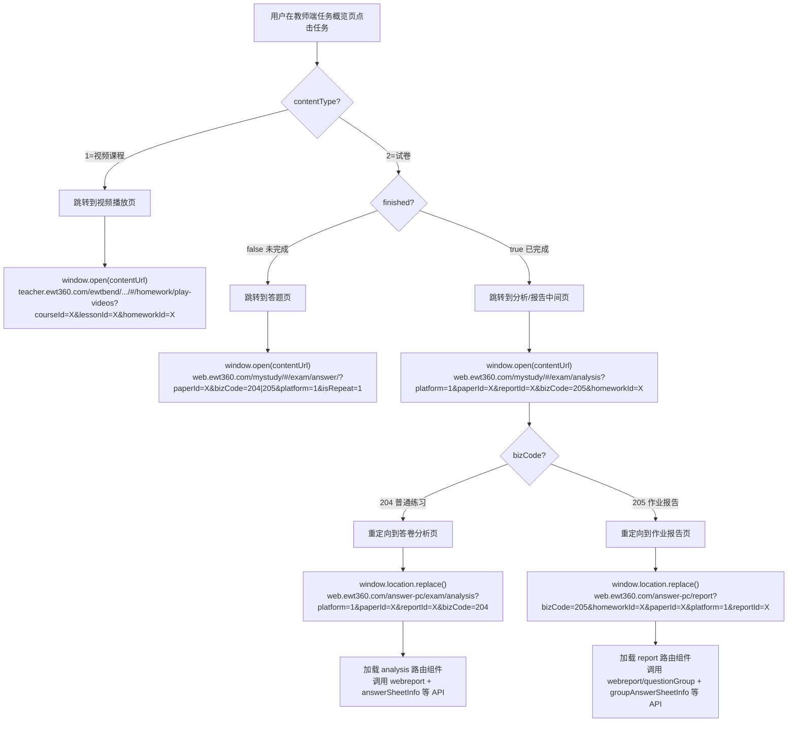

# 页面类型判断与跳转流程文档

> 分析对象：
> - 教师端任务概览页 `https://teacher.ewt360.com/ewtbend/bend/index/index.html#/holiday/student-task-overview?homeworkId=10495544`
> - 中间路由 `https://web.ewt360.com/mystudy/#/exam/analysis`
> - 最终落地页 `/answer-pc/exam/analysis` (bizCode=204) 与 `/answer-pc/report` (bizCode=205)
>
> 分析方式：Edge DevTools MCP 抓取 API 响应、DOM 结构、按钮点击跳转 URL、重定向链路

---

## 1. 核心结论

**页面类型的判断依据是 `bizCode`（业务码）**：

| bizCode | 含义 | 最终落地页 | URL 特征 |
|---|---|---|---|
| `204` | 普通试卷/课后练习 | `/answer-pc/exam/analysis` | 无 `homeworkId` |
| `205` | 作业报告 | `/answer-pc/report` | 必带 `homeworkId` |

**完整跳转链路**：

```
教师端任务概览页
  ↓ 点击任务卡片
mystudy 应用 hash 路由: /mystudy/#/exam/analysis?bizCode=204|205&...
  ↓ JS 重定向 (根据 bizCode)
answer-pc 应用路由:
  bizCode=204 → /answer-pc/exam/analysis (答卷分析页)
  bizCode=205 → /answer-pc/report        (作业报告页)
```

**关键判断逻辑（mystudy 应用内）**：

```javascript
// 伪代码（根据实测重定向行为反推）
if (bizCode === '205' && homeworkId) {
  // 作业报告 → /answer-pc/report
  window.location.href = `/answer-pc/report?bizCode=205&homeworkId=${homeworkId}&paperId=${paperId}&platform=1&reportId=${reportId}`;
} else {
  // 普通练习分析 → /answer-pc/exam/analysis
  window.location.href = `/answer-pc/exam/analysis?bizCode=204&paperId=${paperId}&platform=1&reportId=${reportId}`;
}
```

---

## 2. 教师端任务概览页分析

### 2.1 页面信息

| 属性 | 值 |
|---|---|
| URL | `https://teacher.ewt360.com/ewtbend/bend/index/index.html#/holiday/student-task-overview?homeworkId=10495544` |
| 路由模式 | Hash 路由（`#/holiday/student-task-overview`） |
| 应用 | `ewtbend`（教师端后台应用） |
| 页面标题 | "升学e网通,升学助考一网通" |
| 作业 ID | `10495544`（URL query 参数 `homeworkId`） |

### 2.2 页面布局

```
页面根容器
  ├─ 顶部信息区
  │    ├─ 任务标题: "2025级暑假提升计划（物化生）"
  │    ├─ 状态: "进行中"
  │    ├─ 时间范围: "2026年7月20日～2026年8月21日"
  │    ├─ 布置人: "小e老师"
  │    └─ 完成进度: "已完成 84/98  85.7%"
  │
  ├─ 视图切换: "按天" | "按学科"
  │
  └─ 任务列表区（按天分组）
       ├─ 第1周 7月20日 完成4/4
       │    ├─ 语文 J《六国论》带背与带练1 [视频 13分钟] 导✓ 练✓
       │    ├─ 数学 J复数专题测试卷 [试卷 含讲解 60分钟/13题] 得72分
       │    ├─ 物理 J万有引力与宇宙航行专题测试卷 [试卷 含讲解 60分钟/12题] 得78分
       │    └─ 化学 "位-构-性"与元素周期律 [视频 16分钟] 导✓ 练✓
       │
       ├─ 第2周 7月27日 ...
       └─ ...
```

### 2.3 任务卡片 DOM 结构

每个任务是一个 `<li class="taskItem-ZeyMG">`，包含：

```html
<li class="taskItem-ZeyMG" data-finish="true" data-animation="false">
  <div class="row1-uy7xx">
    <div class="row1_col1-lbQcZ">
      
      <span>语文</span>
    </div>
    <div class="ewt-ellipsis-tooltip-text-content row1_col2-VnB9O single-line">
      J《六国论》带背与带练1
    </div>
  </div>

  <div class="row3-Ndo5z">
    <div class="row3_col1-owiBz">
      
      <span>视频</span>
      <span>13分钟</span>
    </div>
    <div class="row3_col2-uhJci">
      <!-- 视频任务：导学按钮 + 练习按钮 -->
      <div class="btn-AoqsA">
        <span class="text-riKYz">导</span>
        <span class="icon1-YZfB2"><i class="ewt-icon iconfontB iconB-student-qianjin"></i></span>
      </div>
      <div class="btn-AoqsA" data-type="2" data-finish="true">
        <span class="text-riKYz">已学完</span>
        <span class="icon4-PwM0v"><i class="ewt-icon iconfontB iconB-student-wancheng"></i></span>
      </div>
      <div class="btn-AoqsA" data-type="1" data-finish="true">
        <span class="text-riKYz">练</span>
        <span class="icon4-PwM0v"><i class="ewt-icon iconfontB iconB-student-wancheng"></i></span>
      </div>
    </div>
  </div>

  <div class="row4-Rn4TO">
    <span><i class="ewt-icon iconfontB iconB-student-wancheng"></i></span>
  </div>
</li>
```

**试卷任务卡片**（区别）：

```html
<li class="taskItem-ZeyMG" data-finish="true">
  <div class="row1-uy7xx">
    <div class="row1_col1-lbQcZ">
      
      <span>数学</span>
    </div>
    <div class="row1_col2-VnB9O">J复数专题测试卷</div>
  </div>
  <div class="row3-Ndo5z">
    <div class="row3_col1-owiBz">
      
      <span>试卷</span>
      <span>含讲解</span>
      <span>60分钟/13题</span>
    </div>
    <div class="row3_col2-uhJci">
      <!-- 已完成试卷：显示得分按钮 -->
      <div class="btn-AoqsA" data-type="1" data-finish="true">
        <span class="text-riKYz">得72分</span>
        <span class="icon1-YZfB2"><i class="ewt-icon iconfontB iconB-student-qianjin"></i></span>
      </div>
    </div>
  </div>
</li>
```

### 2.4 按钮 data-* 属性含义

| 属性 | 值 | 含义 |
|---|---|---|
| `data-type` | `"1"` | 试卷/练习类任务 |
| `data-type` | `"2"` | 视频/课程类任务 |
| `data-finish` | `"true"` | 已完成 |
| `data-finish` | `"false"` | 未完成 |

---

## 3. 任务列表 API 分析

### 3.1 POST `/api/homeworkprod/student/homework/task/pageHomeworkTasks`

**用途**：分页查询作业任务列表，返回每个任务的完整信息（含跳转 URL）。

**请求体**：
```json
{
  "homeworkId": 10495544,
  "schoolId": 10000,
  "studentId": 160000000,
  "pageIndex": 1,
  "pageSize": 10,
  "queryDateStart": "",
  "queryDateEnd": "",
  "subjectId": 1,
  "taskStatus": 0,
  "taskType": -1,
  "mustLearnSubjectList": [1,2,3,4,5,6,7,8,9,10,11,12]
}
```

> 注意：`queryDateStart`/`queryDateEnd` 和 `subjectId` 不能同时为空，否则返回 `309112` "日期，学科不可同时为空"。

**响应 `data.data[i]` 关键字段**：

| 字段 | 类型 | 含义 | 实测值示例 |
|---|---|---|---|
| `title` | string | 任务标题 | `"J名篇名句默写带背与带练（必修下）专题测试卷"` |
| `contentType` | number | 内容类型 | `1`=视频课程, `2`=试卷 |
| `contentTypeName` | string | 内容类型名 | `"课程讲"` / `"试卷"` |
| `contentId` | string | 内容 ID（试卷时=paperId） | `"2272236290307785228"` |
| `contentUrl` | string | **跳转 URL（已拼好）** | `"//web.ewt360.com/mystudy/#/exam/analysis?platform=1&paperId=...&reportId=...&homeworkId=...&bizCode=205"` |
| `reportId` | string | 报告 ID（视频任务="0"） | `"2318559556986872029"` |
| `homeworkId` | number | 作业 ID | `10495544` |
| `subjectId` | number | 学科 ID | `1` (语文) |
| `subjectName` | string | 学科名 | `"语文"` |
| `finished` | boolean | 是否完成 | `true` |
| `correctStatus` | number | 批改状态 | `0`=未批改, `2`=已批改 |
| `correctType` | number | 批改类型 | `0`=视频, `1`=试卷自动批改 |
| `paperShowType` | number\|null | 试卷展示类型 | `1`=普通试卷, `2`=赋分试卷, `null`=视频 |
| `score` | string\|null | 得分 | `"80"` / `null` |
| `rightRate` | string\|null | 正确率 | `"56.7"` / `null` |
| `duration` | number | 预计用时（秒） | `3600` |
| `questionCount` | number\|null | 题目数 | `15` / `null` |
| `paperBindVideo` | boolean\|null | 试卷是否绑定视频讲解 | `true` / `null` |
| `mustLearning` | number | 是否必学 | `1` |
| `taskStatus` | number | 任务状态 | `30` (已完成) |
| `returned` | number | 是否被退回重做 | `0` |

### 3.2 `contentUrl` 字段是关键

**API 响应中已包含完整的跳转 URL**（`contentUrl` 字段），前端无需自行拼接。

**实测 contentUrl 模式**：

| 任务类型 | contentUrl 模式 | 示例 |
|---|---|---|
| 视频课程 | `https://teacher.ewt360.com/ewtbend/bend/index/index.html#/homework/play-videos?courseId=X&lessonId=X&videoPoint=1&homeworkId=X` | 课程播放页 |
| 试卷（已完成） | `//web.ewt360.com/mystudy/#/exam/analysis?platform=1&paperId=X&reportId=X&homeworkId=X&bizCode=205` | **分析/报告页**（中间路由） |
| 试卷（未完成） | `//web.ewt360.com/mystudy/#/exam/answer/?paperId=X&bizCode=204&platform=1&isRepeat=1` | **答题页** |

> 注意：作业任务（从 homeworkprod 来的）全是 `bizCode=205`；自主练习入口的试卷是 `bizCode=204`。

### 3.3 其他相关 API

| API | 用途 |
|---|---|
| `POST /api/homeworkprod/student/homework/task/getStudentHomeworkInfo` | 获取作业基本信息（标题、时间、必学学科等） |
| `POST /api/homeworkprod/student/homework/task/getStudentHomeworkDaySubjectStat` | 按天/学科统计完成情况 |
| `GET /api/homeworkprod/student/homework/task/getRecentQueryTaskCondition?schoolId=X&homeworkId=X` | 获取最近查询条件 |
| `POST /api/homeworkprod/student/homework/task/refreshTaskProgress` | 刷新任务进度 |
| `POST /api/homeworkprod/student/homework/task/queryStudentLessonStudyGuideAndPractice` | 查询视频导学与练习关联 |
| `POST /api/homeworkprod/student/homework/task/wrongQuestionEliminateStat` | 错题消除统计 |
| `POST /api/homeworkprod/student/homework/task/queryHomeworkTaskCompleteDaySubject` | 查询按天/学科完成情况 |
| `POST /api/homeworkprod/student/homework/task/saveRecentQueryTaskCondition` | 保存最近查询条件 |
| `POST /api/homeworkprod/student/homework/task/showHomeworkTaskSyncPop` | 显示同步弹窗 |
| `POST /api/homeworkprod/student/homework/task/studentMustLearnSubjectChgPop` | 必学学科变更弹窗 |

---

## 4. 跳转流程详解

### 4.1 用户点击任务卡片的跳转流程

```
用户点击任务卡片按钮
  ↓

[步骤 1] 读取 contentUrl 字段
  从 pageHomeworkTasks 响应的 data.data[i].contentUrl 取值
  ↓

[步骤 2] window.open(contentUrl) 新窗口打开
  实测拦截到的 window.open 调用：
  - 视频任务: "//teacher.ewt360.com/ewtbend/bend/index/index.html#/homework/play-videos?..."
  - 试卷已完成: "//web.ewt360.com/mystudy/#/exam/analysis?...&bizCode=205&homeworkId=..."
  - 试卷未完成: "//web.ewt360.com/mystudy/#/exam/answer/?...&bizCode=204&isRepeat=1"
  ↓

[步骤 3] mystudy 应用 hash 路由处理（仅试卷任务）
  mystudy 应用的 /exam/analysis 路由组件 mount
  解析 hash query 参数: bizCode, paperId, reportId, homeworkId, platform
  ↓

[步骤 4] 根据 bizCode 重定向到 answer-pc 应用
  if (bizCode === '205' && homeworkId) {
    // 作业报告
    window.location.replace('/answer-pc/report?bizCode=205&homeworkId=X&paperId=X&platform=1&reportId=X');
  } else {
    // 普通练习分析
    window.location.replace('/answer-pc/exam/analysis?bizCode=204&paperId=X&platform=1&reportId=X');
  }
  ↓

[步骤 5] answer-pc 应用加载
  /answer-pc/exam/analysis → 加载 analysis 路由组件 (bizCode=204)
  /answer-pc/report        → 加载 report 路由组件 (bizCode=205)
```

### 4.2 实测重定向验证

**验证 1：bizCode=204 重定向**

```
输入 URL:
  https://web.ewt360.com/mystudy/#/exam/analysis?platform=1&paperId=2242575400780071280&reportId=2325776270277115987&bizCode=204

重定向后 URL:
  https://web.ewt360.com/answer-pc/exam/analysis?platform=1&paperId=2242575400780071280&reportId=2325776270277115987&bizCode=204

→ 路径: /answer-pc/exam/analysis (答卷分析页)
→ 无 homeworkId 参数
```

**验证 2：bizCode=205 重定向**

```
输入 URL:
  https://web.ewt360.com/mystudy/#/exam/analysis?platform=1&paperId=2272236290307785228&reportId=2318559556986872029&homeworkId=10495544&bizCode=205

重定向后 URL:
  https://web.ewt360.com/answer-pc/report?bizCode=205&homeworkId=10495544&paperId=2272236290307785228&platform=1&reportId=2318559556986872029

→ 路径: /answer-pc/report (作业报告页)
→ 带 homeworkId 参数
→ 参数顺序被重排 (bizCode 在前)
```

### 4.3 跳转 URL 构造规则

**试卷已完成 → 分析/报告页**：

```
// 作业任务 (bizCode=205)
contentUrl = "//web.ewt360.com/mystudy/#/exam/analysis"
           + "?platform=1"
           + "&paperId=" + paperId
           + "&reportId=" + reportId
           + "&homeworkId=" + homeworkId
           + "&bizCode=205"

// 自主练习 (bizCode=204)
contentUrl = "//web.ewt360.com/mystudy/#/exam/analysis"
           + "?platform=1"
           + "&paperId=" + paperId
           + "&reportId=" + reportId
           + "&bizCode=204"
           // 无 homeworkId
```

**试卷未完成 → 答题页**：

```
contentUrl = "//web.ewt360.com/mystudy/#/exam/answer/"
           + "?paperId=" + paperId
           + "&bizCode=204"  // 或 205
           + "&platform=1"
           + "&isRepeat=1"   // 允许重做
```

**视频课程 → 播放页**：

```
contentUrl = "https://teacher.ewt360.com/ewtbend/bend/index/index.html#/homework/play-videos"
           + "?courseId=" + courseId
           + "&lessonId=" + lessonId
           + "&videoPoint=1"
           + "&homeworkId=" + homeworkId
```

---

## 5. bizCode 业务码体系

### 5.1 bizCode 含义

| bizCode | 含义 | 来源 | 典型场景 |
|---|---|---|---|
| `204` | 普通试卷/课后练习 | 自主练习入口、课程附带练习 | 学生自己刷题、课后习题 |
| `205` | 作业报告 | 教师布置的作业 | 寒暑假作业、日常作业 |

### 5.2 bizCode 对页面行为的影响

| 维度 | bizCode=204 | bizCode=205 |
|---|---|---|
| 落地页路由 | `/answer-pc/exam/analysis` | `/answer-pc/report` |
| URL 参数 | 无 `homeworkId` | 必带 `homeworkId` |
| `report` API | 不传 `extId`/`homeworkId` | 传 `extId=homeworkId` & `homeworkId` |
| 报告详情 API | `GET webreport` (扁平) | `GET webreport/questionGroup` (分组) |
| 答题卡 API | `POST answerSheetInfo` (扁平) | `POST groupAnswerSheetInfo` (分组) |
| `assignPoints` | `false` (无赋分) | `true` (有赋分) |
| 得分展示 | 不展示 | 展示 `score`/`myScore` |
| 历史报告 | 调用 `listPaperAnswerReport` | 不调用 |
| 试卷可见性 | 不校验 | 调用 `studyprod/web/paper/visibility` |
| 教师点评 | 不展示 | 展示 `teacherReview*` |
| 鉴权 | 不调用 `studyprod/auth/*` | 调用 `studyprod/auth/function/check` + `auth/live/backplay/authenticate` |

---

## 6. `paperShowType` 字段分析

### 6.1 含义

| paperShowType | 含义 | 实测场景 |
|---|---|---|
| `null` | 非试卷（视频课程） | `contentType=1` |
| `1` | 普通试卷（无赋分） | `contentType=2`, `score=null`, `rightRate="56.7"` |
| `2` | 赋分试卷（有得分） | `contentType=2`, `score="80"`, `rightRate=null` |

### 6.2 与 bizCode 的关系

实测中作业任务（bizCode=205）的试卷有两种 `paperShowType`：

| paperShowType | score | rightRate | correctStatus | contentUrl |
|---|---|---|---|---|
| `1` | `null` | `"56.7"` | `2` (已批改) | `/mystudy/#/exam/analysis?...&bizCode=205` |
| `2` | `"80"` | `null` | `2` (已批改) | `/mystudy/#/exam/analysis?...&bizCode=205` |

**两种都跳转到同一个中间路由** `/mystudy/#/exam/analysis`，最终都重定向到 `/answer-pc/report`。

`paperShowType` 不影响跳转目标，只影响 answer-pc 内部的 UI 展示（如是否显示得分行）。

### 6.3 `correctStatus` 字段

| correctStatus | 含义 | 跳转目标 |
|---|---|---|
| `0` | 未批改（视频任务） | 视频播放页 |
| `2` | 已批改（试卷任务） | 分析/报告页 |

---

## 7. 完整跳转决策流程图



---

## 8. 从 URL 反向判断页面类型

### 8.1 判断规则

给定一个 answer-pc 的 URL，判断页面类型：

```python
def determine_page_type(url: str) -> str:
    """根据 URL 判断 answer-pc 页面类型
    
    返回值:
      - "analysis" : 答卷分析页 (bizCode=204)
      - "report"   : 作业报告页 (bizCode=205)
    """
    from urllib.parse import urlparse, parse_qs
    
    parsed = urlparse(url)
    path = parsed.path
    params = parse_qs(parsed.query)
    
    # 规则 1: 直接看路径
    if path == '/answer-pc/exam/analysis':
        return 'analysis'
    elif path == '/answer-pc/report':
        return 'report'
    
    # 规则 2: 看 bizCode 参数
    biz_code = params.get('bizCode', [''])[0]
    if biz_code == '205':
        return 'report'
    elif biz_code == '204':
        return 'analysis'
    
    # 规则 3: 看是否有 homeworkId
    if 'homeworkId' in params:
        return 'report'
    
    return 'analysis'  # 默认
```

### 8.2 判断规则总结

| 判断条件 | analysis (204) | report (205) |
|---|---|---|
| URL path | `/answer-pc/exam/analysis` | `/answer-pc/report` |
| `bizCode` 参数 | `204` | `205` |
| `homeworkId` 参数 | 无 | 有 |
| `assignPoints` 参数 (analysis URL) | `false` | 不传 |

### 8.3 从 mystudy 中间路由判断

```python
def determine_target_from_mystudy(url: str) -> str:
    """从 mystudy hash 路由判断最终落地页
    
    输入: https://web.ewt360.com/mystudy/#/exam/analysis?bizCode=205&homeworkId=X&...
    输出: /answer-pc/report 或 /answer-pc/exam/analysis
    """
    from urllib.parse import urlparse, parse_qs
    
    parsed = urlparse(url)
    hash_fragment = parsed.fragment  # exam/analysis?bizCode=205&...
    
    if '?' in hash_fragment:
        path_part, query_part = hash_fragment.split('?', 1)
        params = parse_qs(query_part)
    else:
        path_part = hash_fragment
        params = {}
    
    biz_code = params.get('bizCode', [''])[0]
    homework_id = params.get('homeworkId', [''])[0]
    
    if biz_code == '205' and homework_id:
        return '/answer-pc/report'
    else:
        return '/answer-pc/exam/analysis'
```

---

## 9. 教师端页面其他 API 调用时序

```
[页面加载]
1. POST /api/homeworkprod/student/homework/task/getStudentHomeworkInfo
   → 获取作业基本信息 (标题、时间、必学学科列表)
   
2. GET /api/homeworkprod/student/homework/task/getRecentQueryTaskCondition?schoolId=X&homeworkId=X
   → 获取最近查询条件 (上次的日期/学科筛选)
   
3. POST /api/homeworkprod/student/homework/task/refreshTaskProgress
   → 刷新任务进度
   
4. POST /api/homeworkprod/student/homework/task/getStudentHomeworkDaySubjectStat
   → 按天/学科统计完成情况
   
5. POST /api/homeworkprod/student/homework/task/queryHomeworkTaskCompleteDaySubject
   → 查询按天/学科完成详情
   
6. POST /api/homeworkprod/student/homework/task/showHomeworkTaskSyncPop
   → 检查是否显示同步弹窗
   
7. POST /api/homeworkprod/student/homework/task/studentMustLearnSubjectChgPop
   → 检查必学学科是否变更
   
8. POST /api/homeworkprod/student/homework/task/wrongQuestionEliminateStat
   → 错题消除统计
   
9. POST /api/homeworkprod/student/homework/task/pageHomeworkTasks
   → 分页查询任务列表 (核心数据源)
   
10. POST /api/homeworkprod/student/homework/task/queryStudentLessonStudyGuideAndPractice
    → 查询视频导学与练习的关联 (每个视频任务调用一次)
    
11. POST /api/homeworkprod/student/homework/task/saveRecentQueryTaskCondition
    → 保存当前查询条件 (用于下次恢复)
    
[步骤 9-11 循环] 每次切换日期/学科/分页都重复调用

[用户点击任务]
12. window.open(contentUrl)
    → 直接使用 API 返回的 contentUrl 字段，无需额外 API 调用
```

---

## 10. 关键发现总结

1. **`bizCode` 是判断页面类型的唯一核心字段**：`204` → analysis，`205` → report；
2. **`contentUrl` 由后端预拼**：前端无需自行拼接 URL，直接 `window.open(contentUrl)` 即可；
3. **mystudy 是中间路由**：`/mystudy/#/exam/analysis` 根据 `bizCode` 重定向到 `/answer-pc/exam/analysis` 或 `/answer-pc/report`；
4. **`homeworkId` 是 bizCode=205 的标志**：有 `homeworkId` → 作业报告，无 → 普通练习；
5. **`contentType` 区分任务类型**：`1`=视频，`2`=试卷，只有试卷才会跳转到 answer-pc；
6. **`finished` 决定跳答题页还是分析页**：未完成 → `/exam/answer/`，已完成 → `/exam/analysis`；
7. **`paperShowType` 不影响跳转目标**：只影响 answer-pc 内部 UI（是否显示得分）；
8. **`correctStatus=2` 表示已批改**：已批改的试卷才会在 contentUrl 中带 reportId；
9. **作业任务的 bizCode 全是 205**：从 homeworkprod API 来的任务都是作业，不会出现 204；
10. **bizCode=204 的来源是自主练习入口**：如课程页面的"课后习题"、题库自主刷题等。
