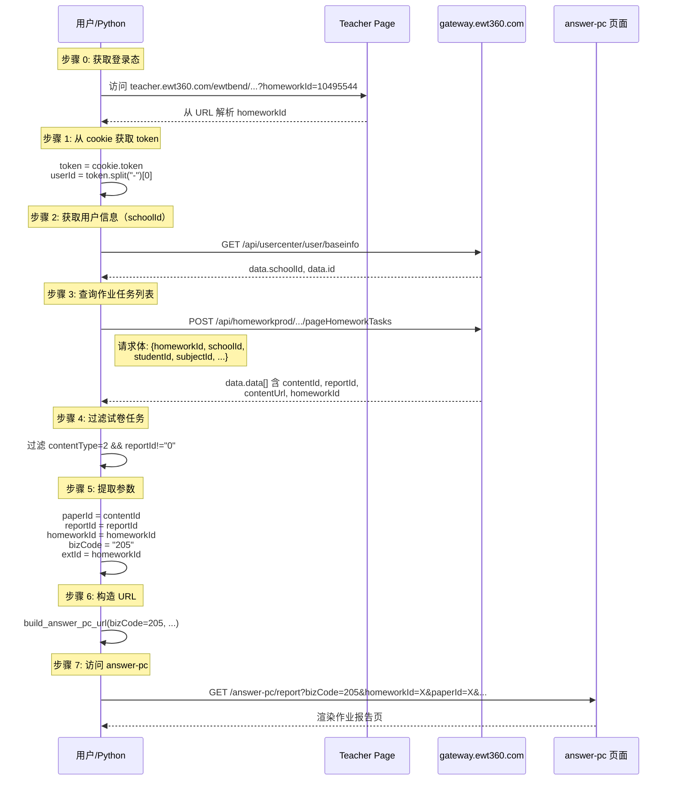

# answer-pc 页面参数获取方式文档

> 分析对象：`/answer-pc/exam/analysis`（bizCode=204）与 `/answer-pc/report`（bizCode=205）页面所需参数的来源与获取方式
>
> 涉及上游页面：
> - 教师端任务概览页 `https://teacher.ewt360.com/ewtbend/bend/index/index.html#/holiday/student-task-overview?homeworkId=X`
> - 学生端自主练习入口 `https://web.ewt360.com/mystudy/#/exam/analysis?...`
> - 答题页 `https://web.ewt360.com/mystudy/#/exam/answer/?...`
>
> 分析方式：Edge DevTools MCP 抓包 + API 响应解析 + URL 参数反推

---

## 1. 参数总览

answer-pc 页面的核心 URL 参数共 7 个：

| 参数 | 类型 | 必填 | 含义 | 主要来源 |
|---|---|---|---|---|
| `paperId` | string | ✓ | 试卷 ID | `pageHomeworkTasks` 响应 `contentId` 字段（试卷任务） |
| `reportId` | string | ✓ | 答题报告 ID | `pageHomeworkTasks` 响应 `reportId` 字段（已批改任务） |
| `bizCode` | string | ✓ | 业务码（204/205） | 入口决定：作业入口=205，自主练习=204 |
| `homeworkId` | string | 205 必填 | 作业 ID | 上游 URL query 参数 / `pageHomeworkTasks` 响应 |
| `userId` | string | ✓ | 用户 ID | 登录态 cookie `token` 第一段 |
| `platform` | string | ✓ | 平台标识（固定 "1"） | 前端常量 |
| `extId` | string | 205 必填 | 扩展 ID（=homeworkId） | 由 `homeworkId` 派生 |

此外还有请求头参数：

| Header | 含义 | 来源 |
|---|---|---|
| `token` | 登录令牌 | 浏览器 cookie `token` |
| `userId` | 用户 ID | 同上，从 token 解析 |
| `platform` | 平台标识 | 前端常量 "1" |
| `bizCode` | 业务码 | URL 参数 |

---

## 2. 各参数详细获取方式

### 2.1 `homeworkId`（作业 ID）

**bizCode=205 场景的必传参数**，标识一份教师布置的作业。

#### 来源 1：教师端 URL query 参数（最上游）

教师端任务概览页 URL 自带：
```
https://teacher.ewt360.com/ewtbend/bend/index/index.html#/holiday/student-task-overview?homeworkId=10495544
                                                                              ↑↑↑↑↑↑↑↑↑↑↑↑↑↑↑↑↑↑↑↑↑
```

解析方式：
```python
from urllib.parse import urlparse, parse_qs

url = "https://teacher.ewt360.com/ewtbend/bend/index/index.html#/holiday/student-task-overview?homeworkId=10495544"
# hash 路由，参数在 fragment 中
fragment = url.split("#", 1)[1]
if "?" in fragment:
    query = fragment.split("?", 1)[1]
    params = parse_qs(query)
    homework_id = params.get("homeworkId", [""])[0]
```

#### 来源 2：`pageHomeworkTasks` API 响应

```json
{
  "data": {
    "data": [
      {
        "homeworkId": 10495544,
        "contentId": "2272236290307785228",
        "reportId": "2318559556986872029",
        "contentUrl": "//web.ewt360.com/mystudy/#/exam/analysis?...&homeworkId=10495544&bizCode=205"
      }
    ]
  }
}
```

字段 `homeworkId` 是 number 类型，整个作业下所有任务的 `homeworkId` 相同。

#### 来源 3：`contentUrl` 字段中解析

`pageHomeworkTasks` 响应的 `contentUrl` 已包含 `homeworkId` 参数：
```
//web.ewt360.com/mystudy/#/exam/analysis?platform=1&paperId=X&reportId=X&homeworkId=10495544&bizCode=205
```

#### 注意

- `bizCode=204`（自主练习）场景**没有** `homeworkId`，不需要此参数；
- `homeworkId` 是作业级别的 ID，一份作业下可有多个任务（视频+试卷），共用同一 `homeworkId`。

---

### 2.2 `paperId`（试卷 ID）

**所有 answer-pc 页面的核心参数**，标识一份具体试卷。

#### 来源 1：`pageHomeworkTasks` API 响应 `contentId` 字段

当任务为试卷类型（`contentType=2`）时，`contentId` 即为 `paperId`：

```json
{
  "contentType": 2,
  "contentTypeName": "试卷",
  "contentId": "2272236290307785228",   // ← 这就是 paperId
  "title": "J名篇名句默写带背与带练（必修下）专题测试卷"
}
```

> 视频任务（`contentType=1`）的 `contentId` 是 lessonId，不是 paperId，不能用于 answer-pc。

#### 来源 2：`contentUrl` 字段中解析

```
contentUrl = "//web.ewt360.com/mystudy/#/exam/analysis?platform=1&paperId=2272236290307785228&reportId=...&homeworkId=...&bizCode=205"
                                                          ↑↑↑↑↑↑↑↑↑↑↑↑↑↑↑↑↑↑↑↑↑↑↑↑↑↑↑↑↑↑↑↑↑↑↑↑↑↑
```

```python
from urllib.parse import parse_qs

content_url = "//web.ewt360.com/mystudy/#/exam/analysis?platform=1&paperId=2272236290307785228&reportId=2318559556986872029&homeworkId=10495544&bizCode=205"
query = content_url.split("?", 1)[1]
params = parse_qs(query)
paper_id = params["paperId"][0]  # "2272236290307785228"
```

#### 来源 3：`listPaperAnswerReport` API（自主练习历史报告场景）

bizCode=204 场景下，从历史报告列表中选取：

```
POST /api/answerprod/web/answer/listPaperAnswerReport
请求体: {"paperId": "<已知paperId>", "platform": "1"}
响应 data[0].reportId  →  用于获取历史 reportId
```

> 注意：此 API 需要先有 paperId，是用于查 reportId 而非 paperId 本身。paperId 通常来自答题页 URL 或课程详情页。

#### 来源 4：答题页 URL 参数（未完成任务场景）

学生答完题前，`contentUrl` 指向答题页：
```
//web.ewt360.com/mystudy/#/exam/answer/?paperId=2271527199796986164&bizCode=204&platform=1&isRepeat=1
```

答完提交后，前端会拿到新的 `reportId`，并跳转到 `/exam/analysis?paperId=X&reportId=X&bizCode=X`。

---

### 2.3 `reportId`（报告 ID）

**标识一次答题的报告**，每答完一次试卷生成一个新 reportId。

#### 来源 1：`pageHomeworkTasks` API 响应 `reportId` 字段（作业场景）

```json
{
  "reportId": "2318559556986872029",
  "correctStatus": 2
}
```

**关键判断**：
- `reportId == "0"` → 任务未答完，无报告，**不能用于 answer-pc**（应跳答题页）
- `reportId != "0"` → 已批改，可用于 answer-pc

#### 来源 2：`contentUrl` 字段中解析

```
contentUrl = "//web.ewt360.com/mystudy/#/exam/analysis?platform=1&paperId=X&reportId=2318559556986872029&..."
```

#### 来源 3：`listPaperAnswerReport` API（bizCode=204 自主练习场景）

自主练习入口没有 `pageHomeworkTasks`，需要查询历史报告：

```
POST /api/answerprod/web/answer/listPaperAnswerReport
请求体: {"paperId": "<已知paperId>", "platform": "1"}

响应 data[]:
[
  {
    "reportId": "2325776270277115987",
    "paperId": "2242575400780071280",
    "userId": 160000000,
    "answerTime": "54",
    "rightRate": "1",
    "finish": true,
    "createTime": "1785848106000"
  },
  ...
]
```

取 `data[0].reportId` 即最近一次报告 ID。

#### 来源 4：`getRecentAnswerReport` API

```
POST /api/answerprod/web/answer/getRecentAnswerReport
请求体: {"paperId": "<paperId>", "platform": "1"}

响应 data.reportId  →  最近一次答题报告 ID
```

#### 来源 5：答题提交接口响应（刚答完时）

学生提交试卷后，批改完成接口返回新的 `reportId`，前端用它跳转到分析页。

#### reportId 的生命周期

```
[开始答题] reportId 不存在
    ↓
[提交试卷] POST /api/answerprod/web/answer/submit → 返回 reportId
    ↓
[批改完成] correctStatus=2, reportId 固化
    ↓
[查看报告] answer-pc 页面使用此 reportId 查询所有报告数据
    ↓
[重新答题] 生成新 reportId，旧 reportId 仍可查历史报告
```

---

### 2.4 `bizCode`（业务码）

**决定页面类型与 API 调用方式的核心字段**。

#### 取值

| bizCode | 含义 | 典型场景 |
|---|---|---|
| `204` | 普通试卷/课后练习 | 自主练习、课后习题、题库刷题 |
| `205` | 作业报告 | 教师布置的作业（寒暑假作业、日常作业） |

#### 来源 1：入口决定（最根本）

| 入口 | bizCode |
|---|---|
| 教师端任务概览页（`teacher.ewt360.com/ewtbend/...`） | `205` |
| 学生端自主练习入口（`web.ewt360.com/mystudy/`） | `204` |
| 课程详情页"课后习题" | `204` |
| 题库自主刷题 | `204` |

#### 来源 2：`pageHomeworkTasks` 响应的 `contentUrl` 中解析

```python
content_url = "//web.ewt360.com/mystudy/#/exam/analysis?...&bizCode=205"
query = content_url.split("?", 1)[1]
biz_code = parse_qs(query)["bizCode"][0]  # "205"
```

#### 来源 3：`answer/report` API 响应中读取

```
GET /api/answerprod/web/answer/report?paperId=X&bizCode=205&...
响应 data.bizCode: 205
```

可用于**校验** bizCode 是否正确。

#### 来源 4：URL query 参数（answer-pc 页面）

```
https://web.ewt360.com/answer-pc/report?bizCode=205&homeworkId=X&paperId=X&platform=1&reportId=X
```

#### bizCode 判断规则总结

```python
def determine_biz_code(source: str, homework_id: str = None) -> str:
    """根据入口判断 bizCode
    
    Args:
        source: 入口类型
            - "teacher_homework" : 教师端作业 → 205
            - "self_practice"    : 自主练习 → 204
            - "url"              : 从 URL 解析
        homework_id: 作业 ID（仅 source="url" 时使用）
    """
    if source == "teacher_homework":
        return "205"
    elif source == "self_practice":
        return "204"
    elif source == "url":
        # 有 homeworkId → 205；无 → 204
        return "205" if homework_id else "204"
    return "204"  # 默认
```

---

### 2.5 `userId`（用户 ID）

#### 来源 1：cookie `token` 解析（最常用）

cookie 中 `token` 格式：`<userId>-<roleId>-<sessionSecret>`

```
token=160000000-1-xxxxxxxxxxxxxxxx
      ↑↑↑↑↑↑↑↑↑↑
      userId = "160000000"
```

```python
def get_user_id_from_token(token: str) -> str:
    """从 cookie token 解析 userId
    
    token 格式: <userId>-<roleId>-<sessionSecret>
    """
    return token.split("-")[0]
```

#### 来源 2：`GET /api/usercenter/user/baseinfo` API 响应

```
GET /api/usercenter/user/baseinfo?<ts>
响应 data.id: 160000000
响应 data.userId: 160000000
```

#### 来源 3：URL query 参数（部分页面）

部分页面 URL 会显式带 `userId`，但多数页面不传，依赖 cookie。

---

### 2.6 `token`（登录令牌）

#### 来源 1：浏览器 cookie

```
Cookie: token=160000000-1-xxxxxxxxxxxxxxxx; ...
```

#### 来源 2：登录接口

```
POST /api/usercenter/user/login
请求体: {"account": "...", "password": "...", ...}
响应 data.token: "160000000-1-xxxxxxxxxxxxxxxx"
```

#### 使用方式

- **Cookie**：浏览器自动注入到所有同域请求；
- **Header**：前端 JS 显式设置 `token: <value>` 请求头（优先级高于 cookie）；
- **Python 端**：需要同时设置 cookie 和 header。

```python
headers = {
    "token": "160000000-1-xxxxxxxxxxxxxxxx",
    "Cookie": "token=160000000-1-xxxxxxxxxxxxxxxx",
    ...
}
```

---

### 2.7 `platform`（平台标识）

**固定值**，前端常量。

| 值 | 含义 |
|---|---|
| `"1"` | PC Web（当前分析对象） |
| `"2"` | H5 移动端 |
| `"3"` | App |

```python
PLATFORM_PC = "1"
```

---

### 2.8 `extId`（扩展 ID）

**bizCode=205 专用**，值等于 `homeworkId`。

```python
ext_id = homework_id if biz_code == "205" else None
```

用途：`GET /api/answerprod/web/answer/report?...&extId=<homeworkId>&homeworkId=<homeworkId>` 时传递。

---

### 2.9 `expectReportStatus`（期望报告状态）

**固定值**，前端常量。

| 值 | 含义 |
|---|---|
| `"2"` | 已完成批改 |

```python
EXPECT_REPORT_STATUS = "2"
```

用途：`GET /api/answerprod/web/answer/report?...&expectReportStatus=2` 时传递，确保返回的是已批改报告。

---

### 2.10 `subjectId`（学科 ID）

#### 来源 1：`pageHomeworkTasks` 请求体参数（输入）

```json
{
  "homeworkId": 10495544,
  "subjectId": 1,
  ...
}
```

| 值 | 学科 |
|---|---|
| `1` | 语文 |
| `2` | 数学 |
| `3` | 英语 |
| `4` | 物理 |
| `5` | 化学 |
| `6` | 生物 |
| `7` | 政治 |
| `8` | 历史 |
| `9` | 地理 |
| `10` | 技术 |
| `11` | 通用技术 |
| `12` | 信息技术 |

#### 来源 2：`pageHomeworkTasks` 响应 `subjectId` 字段（输出）

每个任务都带 `subjectId` 和 `subjectName`。

#### 来源 3：`answer/report` API 响应

```
GET /api/answerprod/web/answer/report?...
响应 data.subjectId: 1
```

---

## 3. 不同入口的参数获取流程

### 3.1 入口 A：教师端作业任务（bizCode=205）

```
[入口 URL]
https://teacher.ewt360.com/ewtbend/bend/index/index.html#/holiday/student-task-overview?homeworkId=10495544
                                                                              ↓
[步骤 1] 从 URL 解析 homeworkId
  homeworkId = "10495544"
                                                                              ↓
[步骤 2] 调用 pageHomeworkTasks API
  POST /api/homeworkprod/student/homework/task/pageHomeworkTasks
  请求体: {"homeworkId": 10495544, "subjectId": 1, "schoolId": X, "studentId": X, ...}
  
  响应 data.data[i]:
    - contentId      → paperId（当 contentType=2）
    - reportId       → reportId（当 correctStatus=2）
    - contentUrl     → 已拼好的跳转 URL
    - homeworkId     → 作业 ID（与输入一致）
    - subjectId      → 学科 ID
                                                                              ↓
[步骤 3] 从响应中提取参数
  对于试卷任务（contentType=2 且 correctStatus=2）:
    paperId    = task.contentId       # "2272236290307785228"
    reportId   = task.reportId        # "2318559556986872029"
    homeworkId = task.homeworkId      # 10495544
    bizCode    = "205"                # 作业入口固定
    extId      = homeworkId           # 派生
    userId     = cookie.token.split("-")[0]
    platform   = "1"
                                                                              ↓
[步骤 4] 构造 answer-pc URL
  https://web.ewt360.com/answer-pc/report?bizCode=205&homeworkId=10495544&paperId=2272236290307785228&platform=1&reportId=2318559556986872029
```

### 3.2 入口 B：自主练习（bizCode=204）

```
[入口]
学生在 web.ewt360.com/mystudy/ 自主选择试卷
                                                                              ↓
[步骤 1] 获取 paperId
  从课程详情页 / 题库列表 / 历史记录中获取 paperId
  例如: paperId = "2242575400780071280"
                                                                              ↓
[步骤 2] 获取 reportId（两种子场景）
  
  场景 B1: 已答过此卷，查看历史报告
    POST /api/answerprod/web/answer/listPaperAnswerReport
    请求体: {"paperId": "2242575400780071280", "platform": "1"}
    响应 data[0].reportId → "2325776270277115987"
    
  场景 B2: 刚答完题
    提交接口返回 reportId
                                                                              ↓
[步骤 3] 构造参数
  paperId    = "2242575400780071280"
  reportId   = "2325776270277115987"   # 来自步骤 2
  homeworkId = 无                       # 自主练习无此参数
  bizCode    = "204"
  extId      = 无
  userId     = cookie.token.split("-")[0]
  platform   = "1"
                                                                              ↓
[步骤 4] 构造 answer-pc URL
  https://web.ewt360.com/answer-pc/exam/analysis?assignPoints=false&bizCode=204&paperId=2242575400780071280&platform=1&reportId=2325776270277115987
```

### 3.3 入口 C：未完成任务先答题（通用）

```
[场景] 任务未完成（finished=false 或 reportId="0"）
                                                                              ↓
[步骤 1] 从 pageHomeworkTasks 拿到 contentUrl（指向答题页）
  contentUrl = "//web.ewt360.com/mystudy/#/exam/answer/?paperId=X&bizCode=204|205&platform=1&isRepeat=1"
                                                                              ↓
[步骤 2] 跳转答题页答完题
  答题提交接口返回新的 reportId
                                                                              ↓
[步骤 3] 用新 reportId 跳转 answer-pc 分析/报告页
```

---

## 4. 参数依赖关系图

```mermaid
flowchart TD
    Cookie[浏览器 Cookie<br/>token=userId-role-secret]
    Cookie --> UserId[userId]
    Cookie --> Token[token]
    
    URL1[教师端 URL<br/>?homeworkId=X] --> HomeworkId[homeworkId]
    
    HomeworkId --> API1[POST pageHomeworkTasks<br/>请求体带 homeworkId]
    API1 --> Tasks[任务列表 data[]]
    
    Tasks --> ContentId[contentId<br/>试卷任务时=paperId]
    Tasks --> ReportId1[reportId<br/>已批改时≠0]
    Tasks --> ContentUrl[contentUrl<br/>已拼好的 URL]
    Tasks --> SubjectId[subjectId]
    
    ContentUrl --> ParseUrl[URL 解析]
    ParseUrl --> PaperId[paperId]
    ParseUrl --> ReportId2[reportId]
    ParseUrl --> BizCode1[bizCode]
    ParseUrl --> HomeworkId
    
    HomeworkId --> BizCode2{作业入口?}
    BizCode2 -->|是| BizCode205[bizCode=205]
    BizCode2 -->|否| BizCode204[bizCode=204]
    
    BizCode205 --> ExtId[extId=homeworkId]
    
    PaperId --> API2[POST listPaperAnswerReport<br/>查历史报告]
    API2 --> ReportId3[reportId<br/>bizCode=204 场景]
    
    UserId --> Headers[请求头]
    Token --> Headers
    BizCode1 --> Headers
    Platform[platform=1<br/>前端常量] --> Headers
    
    PaperId --> FinalUrl[answer-pc URL]
    ReportId1 --> FinalUrl
    ReportId2 --> FinalUrl
    ReportId3 --> FinalUrl
    BizCode1 --> FinalUrl
    BizCode204 --> FinalUrl
    BizCode205 --> FinalUrl
    HomeworkId --> FinalUrl
    ExtId --> FinalUrl
    Platform --> FinalUrl
```

---

## 5. 参数校验规则

### 5.1 必填校验

| 参数 | bizCode=204 | bizCode=205 |
|---|---|---|
| `paperId` | ✓ 必填 | ✓ 必填 |
| `reportId` | ✓ 必填 | ✓ 必填 |
| `bizCode` | ✓ 必填 | ✓ 必填 |
| `homeworkId` | ✗ 不传 | ✓ 必填 |
| `extId` | ✗ 不传 | ✓ 必填（=homeworkId） |
| `userId` | ✓ 必填（header） | ✓ 必填（header） |
| `token` | ✓ 必填（header+cookie） | ✓ 必填（header+cookie） |
| `platform` | ✓ 必填 | ✓ 必填 |
| `expectReportStatus` | ✓ 必填（=2） | ✓ 必填（=2） |

### 5.2 校验函数

```python
def validate_params(biz_code: str, paper_id: str, report_id: str,
                    homework_id: str = None, user_id: str = None,
                    token: str = None) -> list:
    """校验 answer-pc 必填参数
    
    返回缺失参数列表（空列表表示全部通过）
    """
    missing = []
    
    if not paper_id:
        missing.append("paperId")
    if not report_id:
        missing.append("reportId")
    if not biz_code:
        missing.append("bizCode")
    if not user_id:
        missing.append("userId")
    if not token:
        missing.append("token")
    
    if biz_code == "205":
        if not homework_id:
            missing.append("homeworkId")
    
    return missing
```

---

## 6. 完整参数获取 Python 实现

```python
# -*- coding: utf-8 -*-
"""
EWT answer-pc 页面参数获取工具

支持两种入口：
  - 教师端作业入口 (bizCode=205)
  - 自主练习入口 (bizCode=204)
"""

import json
import time
from typing import Any, Dict, List, Optional, Tuple
from urllib.parse import parse_qs, urlparse

import requests


GATEWAY_HOST = "https://gateway.ewt360.com"
PLATFORM_PC = "1"
EXPECT_REPORT_STATUS = "2"


# ============================================================
# 一、身份参数获取
# ============================================================
def get_user_id_from_token(token: str) -> str:
    """从 cookie token 解析 userId
    
    token 格式: <userId>-<roleId>-<sessionSecret>
    示例: "160000000-1-xxxxxxxxxxxxxxxx" → "160000000"
    """
    if not token or "-" not in token:
        raise ValueError(f"非法 token 格式: {token}")
    return token.split("-")[0]


def get_user_baseinfo(token: str) -> Dict[str, Any]:
    """通过 API 获取用户信息（备用方案）
    
    GET /api/usercenter/user/baseinfo
    """
    user_id = get_user_id_from_token(token)
    headers = {
        "token": token,
        "userId": user_id,
        "platform": PLATFORM_PC,
        "Content-Type": "application/json",
    }
    resp = requests.get(
        f"{GATEWAY_HOST}/api/usercenter/user/baseinfo",
        params={"_": int(time.time() * 1000)},
        headers=headers,
        timeout=15,
    )
    return resp.json()


# ============================================================
# 二、作业任务参数获取 (bizCode=205)
# ============================================================
def fetch_homework_tasks(token: str, user_id: str,
                         homework_id: str, school_id: int,
                         subject_id: int = 1,
                         page_index: int = 1, page_size: int = 50) -> Dict[str, Any]:
    """获取作业任务列表（含 paperId/reportId/contentUrl）
    
    POST /api/homeworkprod/student/homework/task/pageHomeworkTasks
    
    返回原始 API 响应
    """
    body = {
        "homeworkId": int(homework_id),
        "schoolId": school_id,
        "studentId": int(user_id),
        "pageIndex": page_index,
        "pageSize": page_size,
        "queryDateStart": "",
        "queryDateEnd": "",
        "subjectId": subject_id,
        "taskStatus": 0,
        "taskType": -1,
        "mustLearnSubjectList": [1,2,3,4,5,6,7,8,9,10,11,12],
    }
    headers = {
        "Content-Type": "application/json",
        "token": token,
        "userId": user_id,
        "platform": PLATFORM_PC,
    }
    resp = requests.post(
        f"{GATEWAY_HOST}/api/homeworkprod/student/homework/task/pageHomeworkTasks",
        json=body, headers=headers, timeout=15,
    )
    return resp.json()


def extract_paper_task_params(tasks_response: Dict[str, Any]) -> List[Dict[str, str]]:
    """从 pageHomeworkTasks 响应中提取试卷任务的 answer-pc 参数
    
    只返回 contentType=2 (试卷) 且 correctStatus=2 (已批改) 的任务
    
    每个元素: {"paperId", "reportId", "homeworkId", "bizCode", "extId", "title", "subjectName"}
    """
    result = []
    data = tasks_response.get("data", {}).get("data", [])
    
    for task in data:
        # 只处理试卷任务
        if task.get("contentType") != 2:
            continue
        
        # 只处理已批改的任务（reportId != "0"）
        report_id = str(task.get("reportId", "0"))
        if report_id == "0":
            continue
        
        homework_id = str(task.get("homeworkId", ""))
        result.append({
            "paperId":      task.get("contentId", ""),
            "reportId":     report_id,
            "homeworkId":   homework_id,
            "bizCode":      "205",   # 作业入口固定
            "extId":        homework_id,
            "title":        task.get("title", ""),
            "subjectName":  task.get("subjectName", ""),
            "subjectId":    str(task.get("subjectId", "")),
        })
    
    return result


# ============================================================
# 三、自主练习参数获取 (bizCode=204)
# ============================================================
def fetch_paper_answer_reports(token: str, user_id: str,
                               paper_id: str) -> Dict[str, Any]:
    """获取试卷的历史答题报告列表
    
    POST /api/answerprod/web/answer/listPaperAnswerReport
    
    用于 bizCode=204 场景，从历史报告中取 reportId
    """
    body = {"paperId": paper_id, "platform": PLATFORM_PC}
    headers = {
        "Content-Type": "application/json",
        "token": token,
        "userId": user_id,
        "platform": PLATFORM_PC,
        "bizCode": "204",
    }
    resp = requests.post(
        f"{GATEWAY_HOST}/api/answerprod/web/answer/listPaperAnswerReport",
        json=body, headers=headers, timeout=15,
    )
    return resp.json()


def extract_latest_report_id(reports_response: Dict[str, Any]) -> Optional[str]:
    """从 listPaperAnswerReport 响应中取最近一次 reportId
    
    响应 data[] 按时间倒序，取 data[0].reportId
    """
    data = reports_response.get("data", [])
    if not data:
        return None
    return str(data[0].get("reportId", ""))


def fetch_recent_report(token: str, user_id: str,
                        paper_id: str) -> Dict[str, Any]:
    """获取最近一次答题报告
    
    POST /api/answerprod/web/answer/getRecentAnswerReport
    """
    body = {"paperId": paper_id, "platform": PLATFORM_PC}
    headers = {
        "Content-Type": "application/json",
        "token": token,
        "userId": user_id,
        "platform": PLATFORM_PC,
        "bizCode": "204",
    }
    resp = requests.post(
        f"{GATEWAY_HOST}/api/answerprod/web/answer/getRecentAnswerReport",
        json=body, headers=headers, timeout=15,
    )
    return resp.json()


# ============================================================
# 四、从 contentUrl 解析参数
# ============================================================
def parse_params_from_content_url(content_url: str) -> Dict[str, str]:
    """从 pageHomeworkTasks 响应的 contentUrl 字段解析 answer-pc 参数
    
    contentUrl 示例:
      //web.ewt360.com/mystudy/#/exam/analysis?platform=1&paperId=X&reportId=X&homeworkId=X&bizCode=205
    
    返回: {"paperId", "reportId", "homeworkId"(可选), "bizCode", "platform"}
    """
    # 补全协议
    if content_url.startswith("//"):
        content_url = "https:" + content_url
    
    # hash 路由，参数在 fragment 中
    if "#" in content_url:
        fragment = content_url.split("#", 1)[1]
        if "?" in fragment:
            query = fragment.split("?", 1)[1]
        else:
            query = ""
    else:
        parsed = urlparse(content_url)
        query = parsed.query
    
    params = parse_qs(query)
    return {k: v[0] for k, v in params.items()}


# ============================================================
# 五、URL 构造
# ============================================================
def build_answer_pc_url(biz_code: str, paper_id: str, report_id: str,
                        homework_id: Optional[str] = None) -> str:
    """构造 answer-pc 页面 URL
    
    bizCode=204 → /answer-pc/exam/analysis
    bizCode=205 → /answer-pc/report
    """
    base = "https://web.ewt360.com"
    
    if biz_code == "205":
        # 作业报告页
        if not homework_id:
            raise ValueError("bizCode=205 必须传 homeworkId")
        return (f"{base}/answer-pc/report?"
                f"bizCode=205&homeworkId={homework_id}&paperId={paper_id}"
                f"&platform=1&reportId={report_id}")
    else:
        # 答卷分析页
        return (f"{base}/answer-pc/exam/analysis?"
                f"assignPoints=false&bizCode=204&paperId={paper_id}"
                f"&platform=1&reportId={report_id}")


def build_request_headers(token: str, biz_code: str) -> Dict[str, str]:
    """构造 API 请求头"""
    user_id = get_user_id_from_token(token)
    return {
        "Content-Type": "application/json",
        "Accept": "*/*",
        "Origin": "https://web.ewt360.com",
        "Referer": "https://web.ewt360.com/",
        "User-Agent": ("Mozilla/5.0 (Windows NT 10.0; Win64; x64) "
                       "AppleWebKit/537.36 (KHTML, like Gecko) "
                       "Chrome/151.0.0.0 Safari/537.36"),
        "token": token,
        "platform": PLATFORM_PC,
        "bizCode": biz_code,
        "userId": user_id,
    }


# ============================================================
# 六、完整获取流程
# ============================================================
def get_params_from_teacher_homework(token: str, homework_id: str,
                                     school_id: int,
                                     subject_id: int = 1) -> List[Dict[str, str]]:
    """完整流程 A：从教师端作业获取所有试卷任务参数
    
    步骤:
      1. 从 token 解析 userId
      2. 调用 pageHomeworkTasks 获取任务列表
      3. 过滤出已批改的试卷任务
      4. 返回每个任务的完整参数
    
    返回: [{"paperId", "reportId", "homeworkId", "bizCode", "extId", "title", "subjectName"}, ...]
    """
    user_id = get_user_id_from_token(token)
    
    # 1. 获取作业任务列表
    resp = fetch_homework_tasks(
        token=token, user_id=user_id,
        homework_id=homework_id, school_id=school_id,
        subject_id=subject_id,
    )
    
    if not resp.get("success"):
        raise RuntimeError(f"pageHomeworkTasks 调用失败: {resp.get('msg')}")
    
    # 2. 提取试卷任务参数
    return extract_paper_task_params(resp)


def get_params_from_self_practice(token: str, paper_id: str) -> Dict[str, str]:
    """完整流程 B：从自主练习入口获取参数
    
    步骤:
      1. 从 token 解析 userId
      2. 调用 listPaperAnswerReport 获取历史报告
      3. 取最近一次 reportId
    
    返回: {"paperId", "reportId", "bizCode": "204", "userId"}
    """
    user_id = get_user_id_from_token(token)
    
    # 1. 查询历史报告
    resp = fetch_paper_answer_reports(token, user_id, paper_id)
    
    if not resp.get("success"):
        raise RuntimeError(f"listPaperAnswerReport 调用失败: {resp.get('msg')}")
    
    # 2. 取最近 reportId
    report_id = extract_latest_report_id(resp)
    if not report_id:
        raise RuntimeError(f"paperId={paper_id} 无历史答题报告")
    
    return {
        "paperId":  paper_id,
        "reportId": report_id,
        "bizCode":  "204",
        "userId":   user_id,
    }


# ============================================================
# 七、使用示例
# ============================================================
if __name__ == "__main__":
    TOKEN = "160000000-1-xxxxxxxxxxxxxxxx"   # 替换为真实 token
    HOMEWORK_ID = "10495544"
    SCHOOL_ID = 10000
    SUBJECT_ID = 1  # 语文
    
    print("=" * 60)
    print("示例 A: 教师端作业入口 (bizCode=205)")
    print("=" * 60)
    
    try:
        tasks = get_params_from_teacher_homework(
            token=TOKEN, homework_id=HOMEWORK_ID,
            school_id=SCHOOL_ID, subject_id=SUBJECT_ID,
        )
        for i, task in enumerate(tasks, 1):
            print(f"\n任务 {i}: {task['title']}")
            print(f"  paperId    = {task['paperId']}")
            print(f"  reportId   = {task['reportId']}")
            print(f"  homeworkId = {task['homeworkId']}")
            print(f"  bizCode    = {task['bizCode']}")
            print(f"  extId      = {task['extId']}")
            
            url = build_answer_pc_url(
                biz_code=task["bizCode"],
                paper_id=task["paperId"],
                report_id=task["reportId"],
                homework_id=task["homeworkId"],
            )
            print(f"  URL        = {url}")
    except Exception as e:
        print(f"失败: {e}")
    
    print("\n" + "=" * 60)
    print("示例 B: 自主练习入口 (bizCode=204)")
    print("=" * 60)
    
    PAPER_ID = "2242575400780071280"   # 替换为真实 paperId
    try:
        params = get_params_from_self_practice(
            token=TOKEN, paper_id=PAPER_ID,
        )
        print(f"\npaperId  = {params['paperId']}")
        print(f"reportId = {params['reportId']}")
        print(f"bizCode  = {params['bizCode']}")
        
        url = build_answer_pc_url(
            biz_code=params["bizCode"],
            paper_id=params["paperId"],
            report_id=params["reportId"],
        )
        print(f"URL      = {url}")
    except Exception as e:
        print(f"失败: {e}")
```

---

## 7. 关键注意事项

### 7.1 参数来源优先级

对于 `paperId` / `reportId` / `homeworkId`：

| 优先级 | 来源 | 说明 |
|---|---|---|
| 1 | `contentUrl` 字段解析 | 后端已拼好，最可靠 |
| 2 | `pageHomeworkTasks` 响应字段 | `contentId` / `reportId` / `homeworkId` |
| 3 | 其他 API 查询 | `listPaperAnswerReport` 等 |

### 7.2 reportId 的有效性判断

```python
def is_report_id_valid(report_id: str) -> bool:
    """判断 reportId 是否有效
    
    "0" 表示未答完/未批改，不能用于 answer-pc
    """
    return bool(report_id) and report_id != "0"
```

### 7.3 bizCode 的不可变性

- 同一份作业下所有任务的 bizCode 都是 `205`（从 `homeworkprod` 来的任务）；
- bizCode 由**入口**决定，不由任务本身决定；
- 自主练习入口的试卷，bizCode 永远是 `204`，即使答了多次。

### 7.4 paperId 与 contentId 的关系

| contentType | contentId 含义 | 可用于 answer-pc? |
|---|---|---|
| `1` (视频) | lessonId（课程节 ID） | ✗ |
| `2` (试卷) | paperId（试卷 ID） | ✓ |

**只有 contentType=2 的任务的 contentId 才是 paperId**。

### 7.5 schoolId / studentId 的获取

`pageHomeworkTasks` 请求体需要 `schoolId` 和 `studentId`：

| 参数 | 来源 |
|---|---|
| `schoolId` | `GET /api/usercenter/user/baseinfo` 响应 `data.schoolId` |
| `studentId` | 等于 `userId`（学生角色下） |

### 7.6 多学科作业的处理

一份作业可能包含多学科任务，`pageHomeworkTasks` 请求体的 `subjectId` 是**必填**的（与 `queryDateStart`/`queryDateEnd` 不能同时为空）。

如需获取所有学科的任务，需要遍历学科列表分别调用：

```python
for subject_id in [1, 2, 3, 4, 5, 6]:  # 语数英物化生
    resp = fetch_homework_tasks(token, user_id, homework_id, school_id, subject_id)
    # 处理 resp...
```

或使用 `taskType=-1` 配合 `queryDateStart`/`queryDateEnd` 获取指定日期所有学科任务。

---

## 8. 参数获取流程总览图



---

## 9. 相关文档

- [API 调用文档](answer_report_api_doc.md) — answer-pc 各 API 的 URL/请求头/请求体/响应
- [页面加载流程](page_loading_flow_doc.md) — 页面从请求到完成的完整加载时序
- [答案展示流程](answer_display_flow_doc.md) — 答案在页面上的渲染流程
- [页面类型路由](page_type_routing_doc.md) — bizCode 如何决定落地页类型
- [Python 测试代码](test_answer_report_api.py) — answer-pc 各 API 的 Python 调用实现
